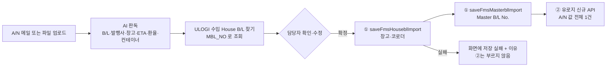

# 수입 A/N 확정 → ULOGI 전송 명세

- 대상: 대시보드 「수입 A/N」 화면에서 담당자가 **[확정]** 을 누른 A/N 1장
- 읽는 분: 유로지(ULOGI) 개발 담당, 장금상선 전산팀

## 1. 방향 — 조회형이 아니라 전송형

선사 청구서에 찍힌 환율과 본선·항차·입항예정일(ETA)은 A/N 에서 읽어 확정 때 함께 보냅니다(§3). 만들지 않는 것은 아래의 조회형 응답입니다.

"Master B/L 번호를 주면 본선·ETD/ETA·환율·House B/L 목록을 돌려주는" 조회형 응답은 만들지 않습니다. A/N 한 장에 없는 값을 만들어 낼 곳이 없기 때문입니다.

| 조회형 항목 | 못 주는 이유 |
|---|---|
| `pol`, `etd` | A/N 에 없습니다 (양하항·입항예정일만 찍힙니다) |
| `house_bls[]` (Master 밑 House 전체) | A/N 1장 = House 1건. 묶음은 ULOGI 가 EDI 로 이미 갖고 있습니다 (`MJOB_NO`) |
| `exchange.basis` | 어느 은행·TTS/TTB·기준일인지 서류에 없습니다 |
| 선사 실시간 스케줄 | 연동돼 있지 않습니다. 별건으로 다룹니다 |

우리가 가진 것은 **A/N 한 장에서 읽은 값**뿐이므로, 확정 시점에 그 값을 1건으로 **밀어 넣습니다**.



## 2. 확정 시 흐름

```
담당자 [확정]
  ├─ ① 지금 하고 있는 저장 (운영 중)
  │     saveFmsHouseblImport  — JOB_NO 로 찾은 수입 House B/L 에 반입 창고(WH_CD·WH_NM·WH_INFO)·코로더(COLD_AGT_CD·COLD_AGT_NM)
  │     saveFmsMasterblImport — 그 House 에 묶인 Master(MJOB_NO) 에 Master B/L No.(MBL_NO)
  └─ ② 유로지 신규 API 로 A/N 값 전체 1건 전송  ← 주소·필드명은 유로지가 정함. 아직 미구현
```

- House 찾기: A/N 에 찍힌 발행사(코로더) B/L 번호를 ULOGI 수입 House B/L 목록의 `MBL_NO` 로 조회합니다 (없으면 선사 B/L 번호로 한 번 더). 수입 건이 정확히 1건이면 확정할 수 있습니다.
- ①이 실패하면 ②를 부르지 않습니다. 화면에는 "저장 실패 + 이유" 가 뜹니다.

## 3. ② 전송 페이로드 (제안)

값은 모두 예시입니다.

```
POST <유로지가 정하는 주소>        인증: 지금 저장 API 와 같은 로그인 세션
{
  "JOB_NO":        "JS26…",           // ULOGI House JOB 번호 — 우리가 찾아낸 것. 이것을 키로 쓰시면 됩니다
  "HBL_NO":        "HALC…",           // 그 House B/L 번호
  "MBL_NO":        "…",               // A/N 발행사(코로더) B/L — ULOGI 의 Master B/L No. 자리
  "CARRIER_BL_NO": "HASL…",           // 선사(흥아·장금) B/L — A/N 에 찍혀 있을 때만. ULOGI 에 칸이 없으면 무시하셔도 됩니다
  "COLD_AGT_CD":   "JP…",  "COLD_AGT_NM": "…",      // 코로더 코드·이름 (코로더 목록으로 정함)
  "WH_CD":         "C …",  "WH_NM": "…",             // 반입 창고 (코로더별 창고 목록으로 정함)
  "CARRY_IN_NO":   "…",               // 搬入確認番号 — 서류에 적힌 그대로
  "VSL_NM":        "…",  "VOY_NO": "…",
  "POD_NM":        "OSAKA",           // 양하지 도시명 — A/N 에 찍힌 영문 그대로
  "POD_CD":        "JPOSA",           // 항구 마스터(MDM_PORT)로 바꾼 코드 — 마스터에 없으면 null
  "ETA_DT":        "20260913",        // A/N 에 찍힌 입항예정일 (YYYYMMDD). 선사 실시간 스케줄이 아닙니다
  "EX_RATE":       161.29,  "EX_CUR": "USD",         // §4
  "CNTR":          [ { "CNTR_NO": "…", "SEAL_NO": "…" } ],
  "PKG":           2,  "GROSS_WT": 253.3,  "MEASURE": 3.122,
  "AN_FILE_NAME":  "….pdf",           // 원본 파일명. 파일 자체가 필요하면 같이 보낼 수 있습니다 (선택)
  "CONFIRMED_BY":  "<확정한 담당자 계정>",  "CONFIRMED_AT": "2026-10-27T15:20:00+09:00",
  "SOURCE":        "MAIL"             // MAIL(사서함으로 온 것) | UPLOAD(화면에 직접 올린 것)
}
응답  { "ok": true }  또는  { "ok": false, "msg": "이유" }
```

### 어디서 읽는 값인가

| 페이로드 | 출처 | 비고 |
|---|---|---|
| JOB_NO · HBL_NO | ULOGI 조회로 찾은 수입 House B/L | |
| MBL_NO | A/N 의 B/L 번호 (발행사 = 코로더) | |
| CARRIER_BL_NO | A/N 의 선사 B/L 번호 | 찍혀 있는 A/N 만. 없으면 null |
| COLD_AGT_CD/NM | A/N 발행사 → 코로더 목록 | |
| WH_CD/NM | A/N 의 반입처 창고명·NACCS 코드 → 코로더별 창고 목록 | `WH_INFO` 는 ①에서 이미 저장 |
| CARRY_IN_NO | A/N 의 搬入確認番号 | 규칙만 적힌 경우("KAM1 + H B/L NO.") 그 문자열 그대로 |
| VSL_NM · VOY_NO | A/N | |
| POD_NM · POD_CD | A/N 의 양하지 도시명 → 항구 마스터 | 코드 변환은 ② 구현 시 적용 |
| ETA_DT | A/N 의 입항예정일 | |
| EX_RATE · EX_CUR | A/N·청구서의 환산 레이트 | §4 |
| CNTR[] | A/N 의 컨테이너 번호·씰 번호 | 번호 없는 행 제외 |
| PKG · GROSS_WT · MEASURE | A/N 의 개수·총중량·용적 | 판독은 하지만 화면에는 아직 보여 주지 않음 |

## 4. 환율 규칙

- **A/N 1장당 환율 1개**: `EX_RATE`(숫자) + `EX_CUR`(그 레이트의 대상 통화). 여러 종류를 보내지 않습니다.
- 서류에 레이트가 둘 이상 찍혀 있으면(A/N 면과 INVOICE/DEBIT NOTE 면이 다를 때) **청구서(INVOICE/DEBIT NOTE) 쪽 값**을 택합니다.
- 표기는 코로더마다 다릅니다 — `Ex.rate 161.29` / `EX. RATE 161.51` / `Ex.Rate@: JPY159.71` / `Exchange Rate ¥166.21` / `(EX¥160.14)`. 숫자만 뽑습니다.
- 레이트가 없는 A/N 도 있습니다 → `EX_RATE`·`EX_CUR` 모두 `null`. 추측해서 채우지 않습니다.
- 지금까지 본 A/N(코로더 10곳 샘플, ULOGI 실제 등록값과 대조)에서 레이트는 전부 **USD→JPY 환산 레이트(159~163)** 였습니다. 다른 통화가 찍힌 A/N 은 아직 없습니다.
- 기준(은행·TTS/TTB·기준일)은 서류에 없어 보내지 않습니다.

## 5. 규칙

- 같은 `JOB_NO` 로 다시 오면 **덮어쓰기** 로 처리해 주시면 됩니다 (값을 고쳐 다시 확정하는 경우가 있습니다).
- 실패(`ok:false` 또는 HTTP 4xx/5xx)는 화면에 "저장 실패 + 이유" 로 뜨고 담당자가 다시 확정하면 다시 보냅니다. 자동 재시도는 하지 않습니다.
- 값이 없는 칸은 `null`. A/N 에 적힌 값만 보내고 서류에 없는 값은 채우지 않습니다.

---

*문의: 장금상선 전산팀*
