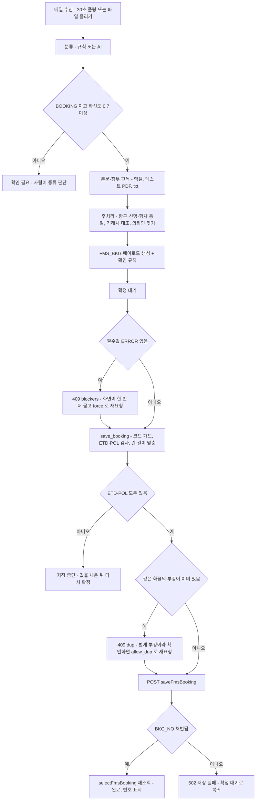
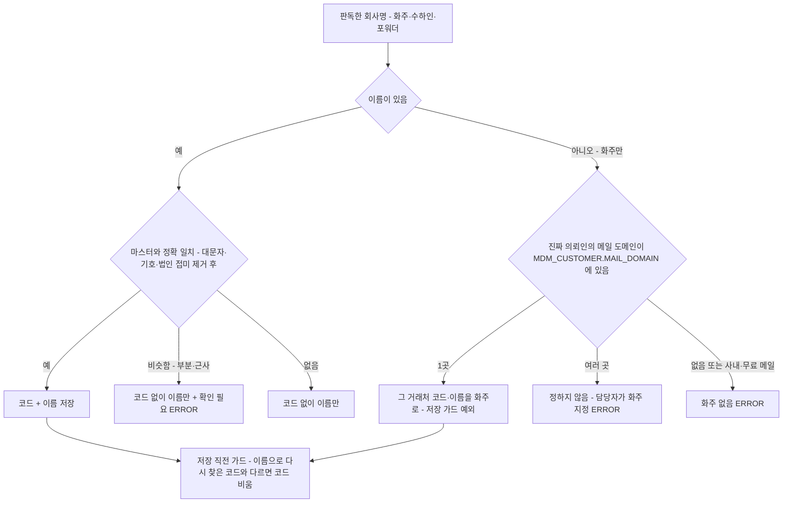
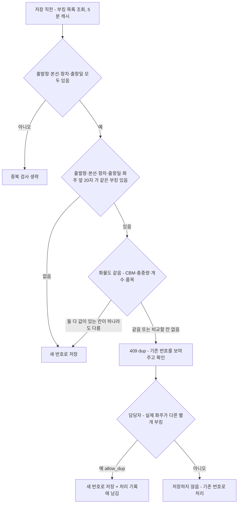

# 부킹 의뢰 → ULOGI 부킹 저장 명세

- 대상: 대시보드 「부킹」 화면에서 담당자가 **[확정]** 을 누른 부킹 의뢰 메일 1통 → ULOGI `saveFmsBooking` 1건
- 읽는 분: 유로지(ULOGI) 개발 담당, 장금상선 전산팀
- 근거 코드: `pipeline.py`(판독·매핑·확인 규칙) · `mail_hdr.py`(의뢰인 찾기) · `ulogi.py`(저장·중복·칸 길이) · `status_app.py`(확정·수정)

## 1. 목적·대상

부킹·S/R 사서함으로 온 메일 가운데 **부킹 의뢰(BOOKING)** 로 분류된 1통에서 값을 읽어 ULOGI 부킹 테이블 `JPSAL.FMS_BKG` 의 컬럼과 1:1 인 `MAIN` 한 덩어리를 만들고 담당자가 확정한 순간에만 `POST /api/fms/booking/saveFmsBooking` 으로 **1건** 저장합니다. `BKG_NO` 는 비워 보내고 ULOGI 가 채번한 번호(`OSAL26…` 꼴)를 받아 화면에 표시합니다. 메일에 없는 값은 채우지 않습니다(추측 금지).

## 2. 흐름

- 저장 API 는 **담당자가 [확정] 을 누른 순간에만** 호출됩니다(`ulogi.save_booking`). 자동 저장·자동 재시도는 없습니다.
- 인증은 `POST /api/login` 세션 하나를 공유하고 세션이 끊기면 한 번만 다시 로그인해 재시도합니다.
- 저장 뒤 `selectFmsBooking` 으로 재조회해 번호를 확인합니다(재조회 실패는 저장 실패로 보지 않음).
- 일괄 확정(`/api/approve_many`)은 중복을 묻지 않고 그 건만 실패로 남깁니다.

## 3. 판독 항목과 FMS_BKG 칸 매핑

판독 프롬프트(`BOOKING_EXTRACT`)가 메일 본문·첨부에서 읽는 항목: `shipper, consignee, notify, forwarder, pol, pod, vessel, voyage, etd, eta, cfs_cut, commodity, package_qty, package_unit, gross_kg, net_kg, cbm, freight_term, dg, un_no, imdg_class, bl_type, customer_ref, remarks, shipper_pic, shipper_tel`. 첨부는 엑셀·텍스트 레이어가 있는 PDF·txt/csv 만 읽고(스캔 PDF 는 부킹 판독에서 제외), 위험물 서류 첨부가 있으면 그 품목표의 UN·Class 가 본문보다 우선합니다.

| 페이로드 칸 | 출처(판독값) | 비고 |
|---|---|---|
| SHP_NM · SHP_CD | shipper | 코드는 §4. 화주가 없으면 보낸 회사 도메인(§4) |
| SHP_PIC_NM · SHP_TEL_NO | shipper_pic · shipper_tel | 메일 서명란의 담당자·전화 |
| CNE_NM · CNE_CD | consignee | 코드는 §4 |
| FWD_NM · FWD_CD | forwarder(乙仲) | 코드는 §4 |
| POL_CD · POL_NM / POD_CD · POD_NM | pol · pod | 영문 도시명으로 읽어 코드표(UN/LOCODE + MDM_PORT 역인덱스)로 코드, 이름은 항구 마스터 명칭. 일본어·약칭(釜山, UKB …)은 별칭표로 통일. 도야마는 `JPTOS` 고정 — `JPTOY` 로 넣으면 번호가 `TOYL…` 로 채번되므로 쓰지 않음 |
| VSL_NM | vessel | 선명 마스터와 대조해 오타 교정(근사 0.82 이상). 교정했으면 '확인 필요' |
| VOY_NO | voyage | `V-`·`VOY.` 접두 제거, 대문자 |
| ETD_DT · ETA_DT | etd · eta | `YYYY-MM-DD`. 연도 없으면 호출 시점의 연도(`fill_year`) |
| ETD_DT_E · ETA_DT_E | 위와 같은 값 | 화면이 함께 보내는 미러 필드 — DB 컬럼이 아닌 API 키 |
| MAIN_ITEM | commodity, 위험물이면 un_no·imdg_class | 위험물이면 **전 품목** `UN<번호> CLASS<등급>, UN<번호> CLASS<등급>` 나열. UN·Class 는 중복 제거 전에 위치대로 짝지음 |
| PKG_QTY · PKG_UNIT_NM · PKG_UNIT_CD | package_qty · package_unit | 코드는 포장단위 마스터(MDM_PKG_UNIT)에서 복수형·약칭(PLT, CTN …) 흡수. 마스터에 없으면 이름만 |
| GROSS_WT · CBM_WT | gross_kg · cbm | 총중량만. 순중량만 적힌 메일은 GROSS_WT 비움. CBM 은 반올림하지 않음 |
| PAY_TERM_CD | freight_term | `P` / `C` |
| DG_YN · DG_UN_NO · DG_CLS | dg · un_no · imdg_class | 칸이 하나라 **첫 품목만**. DG_CLS 는 숫자(`6.1`), 부차위험 괄호는 버림 |
| BKG_RMK | remarks + 시스템 메모 | 일본어 비고 뒤에 `NET …kg` / `NOTIFY …` / `危険物 複数品目: UN … / Class …` 를 ` / ` 로 이어 붙임 |
| MAIL_TITLE · MAIL_FROM · MAIL_TO · MAIL_CC · MAIL_CONTENT | 메일 자체 | §5. DB 컬럼이 아닌 API 키 |

- 판독은 하지만 보내지 않는 값: `cfs_cut`, `bl_type`, `customer_ref`(대응 칸을 두지 않음). `notify`·`net_kg` 는 FMS_BKG 에 컬럼이 없어 비고로만 갑니다.
- 페이로드 키는 `FMS_BKG` 컬럼 목록(`FMS_BKG_COLS`) + 위 API 키 밖이면 코드가 멈춥니다(없는 컬럼을 보내지 않도록).

### 고정값·파생값

| 칸 | 값 | 근거 |
|---|---|---|
| BKG_NO | 빈 문자열 | ULOGI 가 채번 |
| CORP_CD | 고정(산에이 법인 코드) | 운영 설정 |
| BKG_DT | 메일 수신일 | 실제 등록 행을 보고 맞춘 값(부킹일 = 메일 받은 날). 다르면 알려 주세요 |
| BKG_STS | `01` (Booking Input) | CMS_CD_DTL 의 코드. 운영 설정으로 바꿀 수 있음 |
| BKG_PIC_CD · BKG_PIC_NM | 고정(산에이 부킹 담당자) | 운영 설정 |
| LOAD_TP | `L` | 실제 등록 행을 보고 맞춘 값. 다르면 알려 주세요 |
| SVC_TERM_CD | `03` | 실제 등록 행을 보고 맞춘 값(LCL CFS/CFS 로 추정). **다르면 알려 주세요** |
| DG_YN | `Y` / `N` | 판독값 `dg` |
| REG_USER_ID · REG_TM · UDT_* | 보내지 않음 | 서버가 채움 |

## 4. 거래처 코드 규칙

- **정확 일치만 코드**(`cust_cd`): 비교 키는 대문자·기호 제거 후 법인 접미 토큰(CO, LTD, INC, 株式会社 …)을 뺀 3자 이상 문자열. 마스터의 영문명·별칭 모두 대조합니다. 앞부분 일치(양쪽 8자 이상)·근사 일치(0.9)는 코드를 넣지 않고 "시스템 거래처 `<회사명>` 와 비슷함 — 같은 회사인지 확인 필요" ERROR 로 올립니다. 코드가 없어도 이름만으로 저장·업무가 되므로 코드 없음 자체는 경고하지 않습니다.
- **저장 직전 가드**(`drop_guessed_codes`): 담당자가 이름을 고친 뒤에도 코드가 이름과 정확 일치하지 않으면 코드를 비우고 이름만 저장하며 처리 기록에 "코드 없이 저장 — 시스템에서 담당자가 지정 필요" 로 남깁니다.
- **화주가 없을 때 보낸 회사 도메인**(`cust_by_domain`): §5 의 진짜 의뢰인 주소 도메인이 `MDM_CUSTOMER.MAIL_DOMAIN` 에 있으면 그 거래처 코드·이름을 화주로 넣습니다. 하위 도메인은 긴 것부터 대조(`a.b.example.com → b.example.com → example.com`), 한 도메인이 **거래처 코드 여러 곳**에 있으면 고르지 않고 ERROR(화주를 채우면 사라짐). 사내·무료 메일·휴대폰 메일 도메인과 `co.jp` 같은 공용 접미는 등록돼 있어도 보지 않습니다. 이렇게 정한 코드(`_cd_by_domain`)는 코드·이름이 그 값 그대로일 때만 저장 가드를 통과하고 담당자가 하나라도 고치면 원래 규칙으로 돌아갑니다.
- **마스터 동기화**: 전산팀 서버가 **매일 05:40** `MDM_CUSTOMER`(CUST_CD·영문명·현지명·USE_YN·MAIL_DOMAIN)를 1회 조회해 `customers.json` 으로 운영 공유 저장소에 올리고 앱은 파일이 바뀌면 재시작 없이 다시 읽습니다(`tools/sync_customers.py`). 유로지 쪽 운영 규칙: **한 도메인은 거래처 레코드 하나에만** 넣어 주세요.

## 5. 메일 정보 5칸

`MAIN` 에 `MAIL_TITLE / MAIL_FROM / MAIL_TO / MAIL_CC / MAIL_CONTENT` 를 함께 싣습니다. 유로지가 이를 `FMS_MAIL_DATA`(JOB_NO=부킹번호, MAIL_DIV=BKG)에 넣고 화주 회신에 씁니다.

- **진짜 의뢰인 기준**(`mail_hdr.real_requester`): 부킹 의뢰는 대부분 사내에서 전달된 메일이라 봉투의 보낸 사람은 사내 주소입니다. 본문 속 전달 머리글(From/Sent/To/Cc/Subject)을 **바깥→안쪽** 으로 보며 From 주소가 사내 도메인이 아닌 **첫** 블록의 From·To·Cc·Subject 를 씁니다. 그런 블록이 없으면 메일 자체(봉투). From 에 주소가 없으면(표시 이름만) 추측하지 않고 다음 블록으로.
- MAIL_FROM 은 주소 1개, MAIL_TO·MAIL_CC 는 주소만 `; ` 로 이은 문자열. 제목·FROM 은 1000바이트에서 자르고 TO·CC 는 1000바이트를 넘기는 주소부터 통째로 뺍니다(주소 중간에서 자르지 않음). MAIL_CONTENT(CLOB)는 자르지 않습니다.
- MAIL_CONTENT 는 HTML 이면 태그를 걷은 본문. 전달 메일이면 **의뢰인의 From 라벨부터** 끝까지만 — 전달하며 붙인 사내 메모가 회신에 인용되지 않게.
- 빈 값은 보내지 않습니다. 화면에서 MAIL_FROM·TO·CC·TITLE 은 판독값처럼 고칠 수 있습니다.

## 6. 중복 규칙

- 비교 키(`existing_booking`): `POL_CD`·`VSL_NM`·`VOY_NO`·`ETD_DT`·`SHP_NM` 앞 20자(영숫자만 남겨 비교). 목록은 `selectFmsBookingList` 를 5분 캐시하고 목록에 화물 칸이 없으면 그 부킹만 `selectFmsBooking` 으로 다시 읽습니다.
- 화물 비교(`same_cargo`): CBM ±max(0.005, 2%), 총중량 ±max(1kg, 1%), 개수 일치, 품목(MAIN_ITEM) 공백 제거 후 일치. **둘 다 값이 있는 칸이 하나라도 다르면 다른 화물** → 새 번호. 비교할 칸이 없거나 기존 건을 못 읽으면 같은 것으로 보고 묻습니다(모르는 것을 다르다고 하지 않음).
- 화물까지 보는 이유: 같은 수출자·같은 배·같은 일정이라도 실제 화주가 다르면 따로 부킹이 옵니다. 품목·수량까지 같은데 실제 화주가 다른 부킹도 드물게 있고 실제 화주는 FMS_BKG 에 칸이 없어 시스템이 가를 수 없으므로 담당자가 `allow_dup` 로 확인합니다. 확인하고 저장하면 처리 기록에 "같은 화물 부킹 … 이 있었지만 별개 부킹으로 확인" 이 남습니다.
- 이와 별개로 대시보드는 **메일끼리** 30일 안에 같은 의뢰가 두 번 왔는지(`dup_find`: 보낸이·제목 같음, 또는 화주·구간 + 화물값 일치)를 보고 "중복 의심" ERROR 를 올립니다. 이것은 ULOGI 조회가 아니라 받은 메일 간 비교입니다.

## 7. 칸 길이 맞춤

한 칸만 넘어도 `saveFmsBooking` 전체가 500(ORA-12899 추정)으로 실패하므로 저장 직전 `fit_booking` 이 **넘는 값만** 줄입니다. 들어가는 값은 한 글자도 건드리지 않고 줄인 칸은 처리 기록에 "칸 길이를 넘어 줄여서 저장: BKG_RMK 265→250자 …" 로 남깁니다.

| 단위 | 칸 (지금 보내지 않는 칸 포함) | 한도 |
|---|---|---|
| 글자 수 | SHP_NM · CNE_NM · FWD_NM · PKG_UNIT_NM | 100 |
| 글자 수 | SHP_PIC_NM · SHP_TEL_NO · SHP_FAX_NO · CNE_PIC_NM · CNE_TEL_NO · CNE_FAX_NO · FWD_PIC_NM · FWD_TEL_NO · FWD_FAX_NO · VSL_NM · VOY_NO · POL_NM · POD_NM · BKG_PIC_NM | 50 |
| 글자 수 | FRT_RMK · BKG_RMK · RMK | 250 — BKG_RMK 는 뒤의 시스템 메모(NET·NOTIFY·危険物 複数品目)를 남기고 앞의 판독 비고를 `…` 로 줄임 |
| 바이트(UTF-8) | MAIN_ITEM | 56 — 위험물 목록이면 들어가는 품목까지만, 일반 품명은 글자 경계에서 자름 |
| 바이트(UTF-8) | DG_UN_NO 19 · CNTR_INFO 100 · CUST_NM 50 · CUST_EMAIL 200 | |
| 바이트(UTF-8) | MAIL_TITLE · MAIL_FROM · MAIL_TO · MAIL_CC | 1000 (§5, `mail_info` 가 미리 맞춤) |

- 자르지 않는 칸: `LINE_BKG_NO`(20) — 잘린 선사 번호가 조용히 저장되면 안 되므로. 코드 칸(`*_CD`)은 마스터 값이라 줄이지 않고 숫자 칸은 보지 않습니다.
- MAIN_ITEM 은 사전상 400바이트이지만 ULOGI 가 그보다 훨씬 짧은 값(61·65자 일반 품명)도 500 으로 거부하고 56바이트(일본어 20자) 이하만 통과하는 것으로 확인돼 56 으로 둡니다. 생성 단계(`main_item`)는 100바이트(`MAIN_ITEM_MAX`)까지 품목을 담고 넘치는 품목은 비고에만 둡니다. 실제 한도(글자/바이트)는 유로지 확인이 필요한 항목입니다.

## 8. 저장을 막는 조건

| 단계 | 조건 | 동작 |
|---|---|---|
| 확정 전 ERROR(`precheck`) | Shipper 없음 / 도메인 후보가 여럿 / 출발·도착 항구 불명 / 선명·항차·ETD 모두 없음 / 위험물인데 UN번호 없음 / 거래처 이름이 비슷함 / 선명 교정됨 / 출항일이 3일 넘게 지났거나 1년 이상 뒤·형식 이상 / 메일 간 중복 의심 | `/api/approve` 가 409 `blockers` → 화면이 한 번 더 묻고 `force=1` 로 재요청(⚑ 표시) |
| 참고(ALERT, 막지 않음) | 도착일 < 출항일 / 순중량 > 총중량 / 선박·항차 후보 복수 | 표시만 |
| 저장 직전(`save_booking`) | `ETD_DT` 또는 `POL_CD` 없음 — ULOGI 가 POL+출항일로 채번하므로 없으면 500 | 호출하지 않고 "값을 채운 뒤 다시 확정" 으로 실패 |
| 저장 직전 | 같은 화물 부킹 존재(§6) | 409 `dup` → `allow_dup=1` 로 재요청 |
| 저장 중 | HTTP 오류·응답에 BKG_NO 없음 | 502, 확정 대기로 복귀(기록에 "저장 실패 — 이유") |

- 운임조건·중량·용적이 비어도 저장·업무에 지장이 없어(BKG_NO 외 NOT NULL 컬럼 없음) 막지 않습니다.
- **선사 부킹번호는 필요 없습니다**: `BKG_NO` 는 빈 값으로 보내 ULOGI 가 채번합니다. 부킹 메일에 딸린 위험물 품목의 확인 목록(`dg_checks`)은 부킹 확정을 막지 않으며 부킹 단계 위험물 확인은 Booking No.·Container No. 를 아직 없는 값으로 봅니다. 흥아/HASL **LCL** 문구가 있는 메일은 위험물 화면에서도 Booking No. 를 필수로 보지 않습니다.
- 이미 저장된 건(`saved` + 번호)은 다시 확정해도 저장을 부르지 않고 완료 처리만 합니다.

## 9. 확정·수정 규칙

- 확정은 **확정 대기(PENDING)** 상태에서만, 본인 사서함 건만 가능합니다.
- 판독값 수정(`/api/item/{id}/edit`)은 **확정 대기·확인 필요(PENDING·MANUAL)** 상태이고 **ULOGI 에 저장되지 않은 건**만 가능합니다. 저장된 건을 고치면 ULOGI 기록과 어긋나므로 409 로 거부합니다.
- 고치면 페이로드를 판독값 이름으로 역매핑(`_bkg_view`: SHP_NM→shipper, POL_CD→pol …)해 확인 규칙을 그 자리에서 다시 돌리고 요약·목록 줄도 바뀐 칸만 갱신합니다. 메일 간 중복 의심·"서류가 길어" 같은 값과 무관한 지적은 그대로 남습니다. 부킹은 막는 항목이 남아도 확정 대기에 머물고 확정할 때 한 번 더 묻습니다.
- 처음 판독값은 `payload_orig` 로 **한 번만** 보존되며(두 번째 수정이 첫 수정본을 원본으로 덮지 않게), `/edit/reset` 으로 되돌릴 수 있습니다. 기록에 "수정함 N곳 · 누가" 가 남습니다.
- 거래처 이름을 고치면 §4 의 도메인 예외가 풀려 저장 직전 가드가 정확 일치 규칙으로 다시 봅니다.
- 삭제는 본인 사서함 건만, **ULOGI 에 저장된 건은 삭제 불가**(이력 유지).

## 10. 한계·미구현

- 거래처 코드가 정확 일치하지 않으면 **이름만** 저장됩니다. 코드는 ULOGI 화면에서 담당자가 고릅니다.
- 연도 없는 날짜(`ETD9/8`)는 **서버 기준 올해**로 읽습니다 — 12월에 온 1월 ETD 는 한 해 앞서 읽히고 "출항일이 이미 지났음" 으로 확인 필요가 됩니다.
- 위험물 여러 품목은 `DG_UN_NO`·`DG_CLS` 에 첫 품목만 들어가고 부차위험은 `DG_CLS` 에 담지 못합니다(전체는 MAIN_ITEM·비고).
- 스캔 PDF 첨부는 부킹 칸 판독에서 읽지 않습니다(텍스트 레이어가 있는 PDF·엑셀·txt 만). 위험물 서류 첨부만 별도 판독기가 읽어 UN·Class 를 보완합니다.
- 포장단위 코드는 마스터가 없을 때 PT/PK 만 압니다. 항구 코드는 UN/LOCODE 기준이라 ULOGI 코드 마스터와 대조가 필요합니다.
- 확인 중인 항목(현업·유로지 답을 받으면 반영): BKG_STS 01/04, SVC_TERM_CD, PKG_UNIT_CD 범위, DG_CLS 부차위험, PAY_TERM_CD.
- 부킹 메일에 딸려 온 위험물 품목(`dg_payload`)은 화면에서 고칠 수 없습니다.

---

*문의: 장금상선 전산팀*
