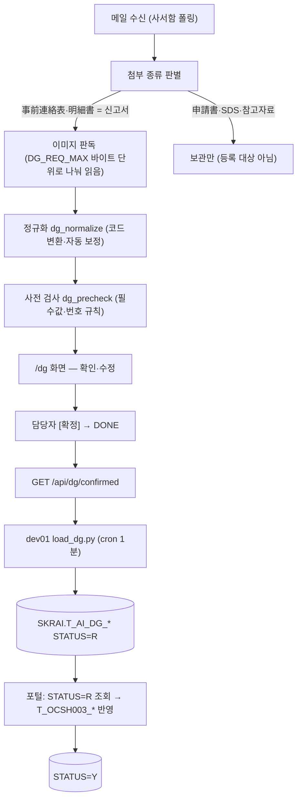
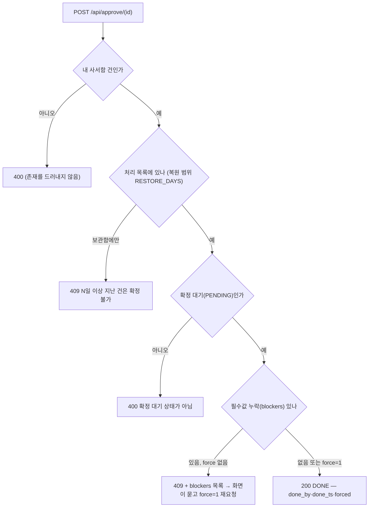
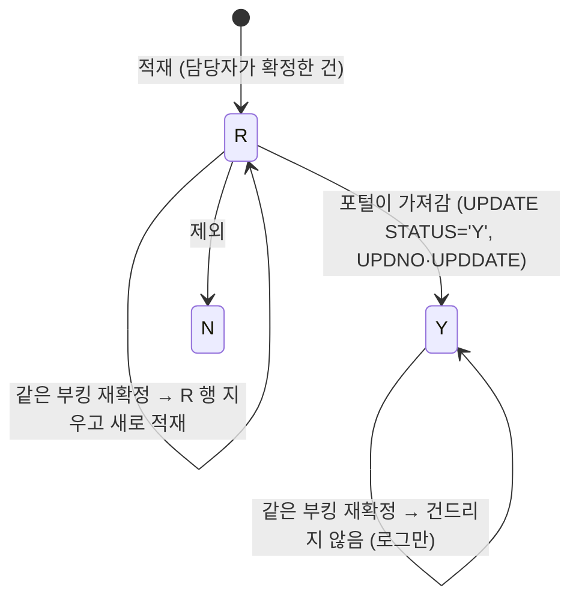
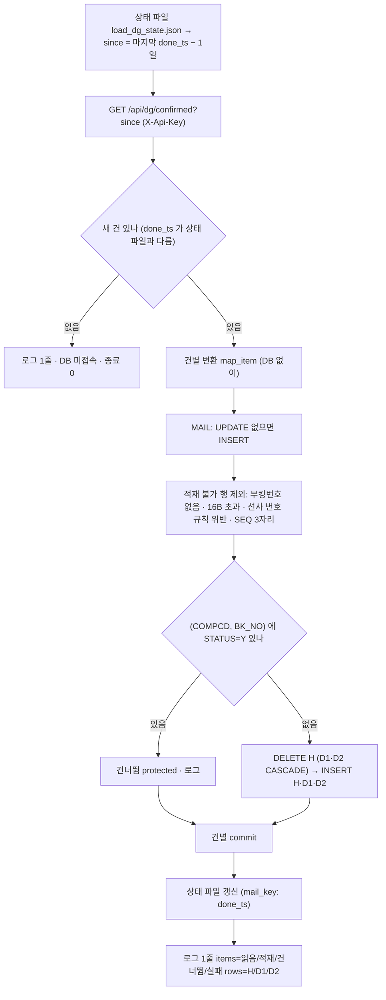

# 위험물(DG) 판독 → 담당자 확정 → SKRAI 적재 → 포털 반영 명세

- 대상: 대시보드 「위험물(`/dg`)」 화면에서 담당자가 **[확정]** 을 누른 위험물 메일 1통(품목 SEQ 여러 건)
- 읽는 분: 장금 포털 담당자(Special Cargo 등록), 장금상선 전산팀
- 한 줄 요약: 확정된 품목을 AI 전용 스키마 **SKRAI** 의 테이블 4개에 포털 `T_OCSH003_*` 와 같은 칸 이름으로 넣어 둡니다(STATUS=R). 포털이 가져간 뒤 **Y** 로 바꾸면 우리는 그 부킹을 다시 건드리지 않습니다.

## 1. 목적·대상

| 항목 | 내용 |
|---|---|
| 하는 일 | 일본사무소 사서함에 온 위험물 서류(事前連絡表·明細書)를 AI 가 읽어 포털 Special Cargo 입력값(품목·컨테이너·포장)으로 만들고, 담당자 확정 뒤 Oracle `SKRAI` 에 적재 |
| 하지 않는 일 | 포털 `LINER/HLINER.T_OCSH003_*` 에 직접 쓰지 않음(권한 없음). 패키지·프로시저도 만들지 않음(시스템팀 소유) |
| 회사 구분 | `COMPCD` — 장금 `SNKO` · 흥아 `HALK`. 받은 **사서함 역할**로 정함(장금 도쿄 사서함 → SNKO, 흥아 사서함 → HALK). 그 외 사서함 건은 적재하지 않고 기록만 |
| 등록자 | `EMPNO` = 담당자 사번(사서함별 고정값) |
| 주기 | dev01 적재 프로그램 `tools/load_dg.py` 를 cron **1분마다** 실행. 새로 확정된 건이 없으면 DB 에 접속하지 않음 |

## 2. 전체 흐름



## 3. 대상 서류와 판정

| 첨부 종류 (`attachment_kind`) | 판정 | 처리 |
|---|---|---|
| `DG` — 危険物又は有害物事前連絡表 · 危険物明細書(DGD, DG CERT) | **신고서** | 포털 등록 근거. 판독 대상 |
| `DG_APP` — 危険品申請書 / DG APPLICATION | 신청서 | 등록 대상 아님. 보관하고 부킹 건의 UN·Class 참고에만 사용 |
| `MSDS` · `OTHER`(積載可否·UN 一覧 등) | 참고자료 | 읽지 않음 |

- **連絡表 + 明細 가 함께 오면 明細가 정본**(`dg_candidates`): 같은 묶음(파일명의 선사 부킹번호 16자리, 없으면 連絡表·明細 표기를 뺀 이름)에 連絡表이 있으면 신고서만 읽습니다. 둘 다 읽으면 같은 품목이 두 번 등록되기 때문입니다. 엑셀 품목표가 있으면 그것이 정본입니다.
- **긴 서류**: PDF 는 쪽 이미지로 바꿔 최대 `DG_MAX_PAGES`(120)쪽까지, 한 요청은 `DG_BATCH`(24)쪽·`DG_REQ_MAX`(24MB, base64 합계) 둘 다 넘지 않게 나눠 보내고 합칩니다. 엑셀은 표 텍스트로 같은 프롬프트를 씁니다.
- **흥아 LCL**: 메일 제목·본문에 흥아/HASL + LCL 문구가 있으면(`LCL_NO_BKG_RX`) 부킹번호가 필수에서 빠지고, 메일에 적힌 Master B/L 을 Booking No. 로 넣습니다(자동 보정에 기록). Master B/L 도 없으면 Booking No. 없이 확정은 되지만 **적재 단계에서 그 행은 키가 없어 빠집니다**(§8.1).

## 4. 판독 항목과 정규화·자동 보정

판독 결과는 품목(SEQ) 1건 = 포털 Sequence 1건입니다. 모델에는 "추측 금지, 서류에 없는 값은 null" 로 지시합니다. `SUB RISK` 는 "없음" 이 명시된 경우 `NONE`(읽어내지 못한 null 과 구분).

| 항목 | 규칙 (`dg_normalize`) | 자동 보정 기록(`_auto`) |
|---|---|---|
| Booking No. | 공백 제거·대문자. 선사 번호 규칙(HASL/SNKO 16자리, 월 01~12)에 맞게 O→0·S→5 같은 판독 흔들림과 `SNKO00…` 17자리만 고침. 그래도 안 맞으면 **고치지 않고** 확인 필요 | `Booking No. … → …` |
| Container No. | 공백 제거. ISO 6346 검증자리가 안 맞으면 고치지 않고 확인 필요 | `Container No. 검증자리 불일치 — …(고치지 않음)` |
| Outer Package Type | ① 서류의 용기 기호(`UN 1A1/…` → `1A1`)가 포털 코드표(`dg_pkg_codes.json`, 77개)에 있으면 그 코드 ② 코드가 하나뿐인 이름만 바꿈(TANK→`T/C`, CYLINDER(S)→`CYL`) ③ `CONTAINER(S)` 만 적혔으면 같은 품목의 TPSZ(TANK·ISO 코드 셋째 자리 T)나 품명 문구에 탱크 근거가 있을 때만 `T/C`. DRUM 처럼 코드가 여럿인 이름·PORTABLE TANK 는 그대로 | `… Type … → 1A1 (서류의 용기 기호)` / `… → T/C (탱크 근거: TPSZ …)` |
| EMS Contact No | 30B(`CONTACT_NO_MAX`)를 넘고 번호가 둘 이상이면 들어가는 **첫 번호만**(`contact_first`). 번호 하나가 긴 경우는 자르지 않고 확인 필요 | `EMS Contact No '…' → '…' (포털 칸 30바이트 — 첫 번호만)` |
| NET / Gross Weight | NET 이 0 이고 G/W 가 있으면 NET=G/W. 빈 탱크(EMPTY TANK·残存物 등) 문구가 있으면 G/W=NET | `NET Weight 0 → G/W …` / `EMPTY TANK — Gross Weight … → NET 과 같게 …` |
| POL / POD | 항구 마스터로 코드 변환 | `POL … → …` |
| Sequence | 부킹번호별로 1부터 다시 매김(`renumber_seq`) — 포털이 부킹 단위로 등록하기 때문 | — |

- 자동 보정 기록은 누적입니다. 재시작 복원 때 **지금 규칙을 다시 적용**(`dg_renorm`)해도 앞선 기록은 남기고 새 것만 덧붙입니다. 확정(DONE)된 건·담당자가 화면에서 고친 건에는 다시 적용하지 않습니다.

## 5. 확인 규칙·필수 항목·확정 API

**필수 항목**(`DG_XL_REQUIRED`, 비면 ERROR → 확정 때 한 번 더 물음): Booking No. · Container No. · UN CODE · Class No(IMDG) · SUB RISK · Packing GROUP — 6항목. Certificate No. 는 필수가 아닙니다(읽히면 채움). 예외: Class 2 는 Packing GROUP 면제, 흥아 LCL 은 Booking No. 면제. 그 밖의 ERROR(`dg_precheck`): 부킹번호 규칙 위반, 컨테이너 검증자리 불일치, EMS Contact No 30B 초과(줄이지 못한 경우), 품목 0건. 화면 `/dg` 는 `/api/dg`(items·problems·required·restore_days)로 그리며, 건별·일괄 엑셀(`/api/dg/export.xlsx`·`.zip`)은 그대로 남아 있습니다.



| 항목 | 내용 |
|---|---|
| 확정 대상 | 위험물 메일 건(task `DG_NOTICE`)의 확정 대기만. 보관만(MANUAL)·부킹/S/R 에 딸린 위험물은 확정 버튼 없음 |
| 누가 | 그 사서함 계정·관리자·API 키. `done_by` 에 확정한 계정이 남음 |
| 확정 뒤 | 수정 불가(`/api/item/{id}/edit` → 409), 재확정 400, 삭제는 가능. 포털·ULOGI 저장은 부르지 않고 **적재 대상 표시만**(`saved=false`) |
| 일괄 | `POST /api/approve_many` {ids}. 확정 대기가 아니거나 범위 밖·없는 id 는 `skipped`, 필수값 누락은 `blocked`(force 로 재요청), 다른 사서함 건은 조용히 건너뜀 |
| 조회 | `GET /api/dg/confirmed?since=<epoch>` — `X-Api-Key`(적재 프로그램 전용 키)면 전 사서함, 로그인 쿠키면 자기 사서함. 복원 범위 안의 DONE 건 중 품목이 있는 것만, `done_ts` 오름차순. 요소: id·mail_id·mailbox·subject·sender·date·received·ts·done_ts·done_by·forced·attachments·checks·dup·**rows**(SEQ별 dict 그대로) |
| 복원 범위 | `RESTORE_DAYS` 기본 30일(받은 날 기준). 그 밖의 건은 화면에 「N日超 · 確定不可」 |

## 6. SKRAI 테이블 4개

스키마 `SKRAI` 는 AI 전용입니다. 포털 `T_OCSH003_H_NEW / D1 / D2` 의 칸 이름·타입·길이를 그대로 복사하고 앞에 `COMPCD`(+`MAILKEY`)를 붙였습니다. 문자 칸은 모두 BYTE. DDL: `docs/sql/dg_staging_ddl_draft.sql`.

| 테이블 | 내용 | PK | FK |
|---|---|---|---|
| `T_AI_DG_MAIL` | 원본 메일·확정 정보 (메일 1통 = 1행) | (COMPCD, MAILKEY) | — |
| `T_AI_DG_H` | 위험물 품목 = `T_OCSH003_H_NEW` | (COMPCD, BK_NO, SEQ) | → MAIL (COMPCD, MAILKEY) |
| `T_AI_DG_D1` | 컨테이너 = `T_OCSH003_D1` | (COMPCD, BK_NO, BK_SEQ, CONT_NO) | → H **ON DELETE CASCADE** |
| `T_AI_DG_D2` | 포장 = `T_OCSH003_D2` | (COMPCD, BK_NO, SEQ, GB, DSEQ) | → H **ON DELETE CASCADE** |

인덱스: `T_AI_DG_H_IDX01 (COMPCD, STATUS)` — 포털이 R 만 가져갈 때 · `T_AI_DG_H_IDX02 (COMPCD, MAILKEY)` — 메일 단위 교체. CHECK: `STATUS IN ('R','Y','N')`, `GB IN ('O','I','M')`, `DSEQ IN ('F','S')`.

### 6.1 `T_AI_DG_MAIL`

| 칸 | 길이 | 값 |
|---|---|---|
| COMPCD / MAILKEY | 4 / 64 | 회사코드 / 메일 식별자 SHA-256 hex(다시 처리해도 같음) |
| ITEMID · MAILBOX · FRADDR · SUBJECT · SRCFILES | 8 · 100 · 100 · 200 · 1000 | 대시보드 건 id · 받은 사서함 · 보낸 사람 · 제목 · 읽은 첨부 파일명 |
| RCVDATE · CONFIRM_DATE · INPDTTM | 14 | 받은 시각 · 확정 시각 · 적재 시각 (YYYYMMDDHH24MISS, JST) |
| CONFIRM_USER · FORCED_YN | 100 · 1 | 확정한 계정 · 필수값이 빠진 채 확정이면 Y |
| RMK | 200 | 적재 못 한 행 수 `未登載 n行(Booking No.なし等)` |

### 6.2 `T_AI_DG_H` — 포털 `T_OCSH003_H_NEW` 와 같은 칸

| 칸 | 길이 | 우리가 넣는 값 |
|---|---|---|
| BK_NO · SEQ | 16 · 2 | Booking No.(공백 제거·대문자) · 부킹별 `01` 부터 |
| UN_CD · DNH_CD · SUB_RISK · PACKING_GROUP | 4 · 15 · 15 · 30 | UN(앞의 `UN` 제거) · Class · SUB RISK(`NONE`/빈값→NULL, `3 & 8` 같은 복수는 그대로) · I/II/III |
| EMS · DNH_NM · TECHNICAL_NM · SAPT · FLASH_POINT | 50 · 1000 · 250 · 250 · 20 | EmS · D/G NAME · Technical Name · SAPT · 인화점(문자, 28.0→`28`) |
| CONTACT_NO · CONTACT_NM | 30 · 100 | 연락처(30B 넘으면 첫 번호, 안 되면 자름 — 원문은 RMK) · 이름 |
| POLLUTANT · LIMITED_QTY · EXCEPTED_QTY | 1 | Y / N / NULL |
| NET_WGT · GRS_WGT | NUMBER | kg (숫자만, 못 읽으면 NULL) |
| PACK_DESC · CONTRACT_NO | 200 · 17 | Description · Certificate No.(검사증 번호) |
| STATUS · EMPNO · INPDATE | 1 · 6 · 14 | **항상 `R`** · 담당자 사번(사서함별 고정) · 적재 시각 |
| UPDNO · UPDDATE | 6 · 14 | **포털 칸** — 우리는 쓰지 않음 |
| RMK | 2000 | 포털 칸이 없는 판독값·자동 보정·확인 사항(일본어, §8.3) |

짧은 코드 칸(UN_CD·DNH_CD·SUB_RISK·PACKING_GROUP·CONTRACT_NO·FLASH_POINT)은 길이를 넘으면 잘라 넣지 않고 **비운 뒤 RMK 에 원문**을 남깁니다. PSA·WGT_RST·SEG_GROUP(포털 Prechecking 계산값)·MAIL_*·EDM_*·APPNO(포털 발송·EDI 이력)는 두지 않았습니다.

### 6.3 `T_AI_DG_D1` — 포털 `T_OCSH003_D1` 과 같은 칸

우리가 채우는 칸: `BK_SEQ`(=H.SEQ) · `CONT_NO`(11, 영숫자 대문자) · `SEAL`(15) · `PKG` NUMBER(7,0) · `GRS_WGT` NUMBER(13,3) · `SOC`(SOC=Y / COC=N / 없음 NULL) · `RMK`(200, `TPSZ原文: …`·`Seal原文: …`).
**NULL 로 두는 칸**(포털은 NOT NULL 이지만 서류에 없는 값이 많아 여기서는 NULL 허용 → 포털 담당자가 옮길 때 채움): `TPSZ1`·`TPSZ2`(관세청·항만청 코드 — 서류엔 `20' TANK` 같은 원문뿐이라 코드로 못 바꿈, 원문은 RMK) · `UNIT` · `NET_WGT` · `MSR` · `F_L` · `CERTI_SEQ` · `CERTI_NO`.

### 6.4 `T_AI_DG_D2` — 포털 `T_OCSH003_D2` 와 같은 칸

| 칸 | 값 |
|---|---|
| GB · DSEQ | O=외장 · M=중간 · I=내장 / F=1st · S=2nd — Q'ty 나 Type 이 있는 조합만 |
| PACKING_CD (10) | 외장의 용기 기호(`UN 1A1/…` → `1A1`)가 있으면 그것. 없으면 Type 이 이미 포털 코드일 때만(`T/C`·`CYL`·코드표·`^[0-9]{1,2}[A-Z]{1,2}[0-9]?$`·`/` 포함). DRUM 같은 이름은 NULL |
| PACKING_NM (200) · PACKING_QTY | 서류에 적힌 Type 이름 · 수량 |

## 7. STATUS 와 포털용 예문



| 상태 | 뜻 | 누가 바꾸나 | 재확정 시 |
|---|---|---|---|
| R (request) | 확정됨 — 포털이 가져갈 차례 | 적재 프로그램 | 부킹 단위로 교체 |
| Y (confirm) | 포털 반영 완료 | 포털 담당자 | **건드리지 않음** — 포털이 Y 로 바꾼 부킹은 우리가 다시 쓰지 않습니다 |
| N (reject) | 제외 | 포털 담당자·운영자 | 건드리지 않음 |

포털용 예문입니다. 권한은 `SELECT` + `UPDATE (STATUS, UPDNO, UPDDATE)` 로 계획돼 있고, **포털 담당자 계정 확인 후 부여 예정**(아직 미부여).

```sql
-- ① 가져갈 품목 (회사별) — 인덱스 T_AI_DG_H_IDX01
SELECT * FROM SKRAI.T_AI_DG_H WHERE COMPCD = 'SNKO' AND STATUS = 'R' ORDER BY BK_NO, SEQ;
-- ② 그 품목의 컨테이너·포장·원본 메일
SELECT * FROM SKRAI.T_AI_DG_D1   WHERE COMPCD = :c AND BK_NO = :b AND BK_SEQ = :s;
SELECT * FROM SKRAI.T_AI_DG_D2   WHERE COMPCD = :c AND BK_NO = :b AND SEQ = :s;
SELECT * FROM SKRAI.T_AI_DG_MAIL WHERE COMPCD = :c AND MAILKEY = :k;
-- ③ 반영 뒤 — 부킹 단위로 Y (이후 적재 프로그램은 이 부킹을 건드리지 않음)
UPDATE SKRAI.T_AI_DG_H SET STATUS = 'Y', UPDNO = :담당자사번, UPDDATE = TO_CHAR(SYSDATE, 'YYYYMMDDHH24MISS')
 WHERE COMPCD = :c AND BK_NO = :b AND STATUS = 'R';
```

## 8. 적재 프로그램 `tools/load_dg.py`



### 8.1 규칙

| 규칙 | 내용 |
|---|---|
| 교체 단위 | **(COMPCD, BK_NO)**. 같은 부킹이 다시 확정되면 H 를 지우고(D1/D2 는 CASCADE) 새로 넣음. 같은 부킹이 두 메일에 있으면 늦게 확정한 쪽이 남음(done_ts 순) |
| Y 보호 | 그 부킹의 H 에 `STATUS='Y'` 가 하나라도 있으면 손대지 않고 로그 「포털이 이미 가져감」(`protected`) |
| 트랜잭션 | 메일 1건 = 1트랜잭션(건별 commit). 실패하면 rollback 하고 다음 건, 끝에 종료코드 1 → 다음 실행에서 재시도 |
| 멱등 | 상태 파일에 `{mail_key: done_ts}`. done_ts 가 같은 건은 다시 보내지 않음 — 두 번 돌려도 테이블이 같음. 새 건이 없으면 DB 호출 0 |
| 적재 불가 행 | Booking No. 없음 / 16B 초과 / 선사 번호(SNKO·HASL) 규칙 위반(`bkg_rule_ok` — 손글씨 오독을 키로 넣지 않음, 산에이 자체 번호는 규칙 대상 아님) / SEQ 2자리 초과 → 그 행만 빼고 로그 + `T_AI_DG_MAIL.RMK`. 화면에서 번호를 채워 다시 확정하면 들어감 |
| 바이트 | 모든 VARCHAR2 는 UTF-8 바이트로 재고 글자 경계에서 자름. 키 칸은 자르지 않고 적재 불가. 숫자 칸은 숫자만 |
| 컨테이너 | 번호 없는 행 제외, 같은 SEQ 안 중복 번호는 첫 것만, 11B 초과는 D1 적재 불가 |
| DB 접근 | 연결 1개·순차·call_timeout 15초·키로만 접근(공용 운영 DB 규칙). 비밀값은 로그·화면에 찍지 않음 |

### 8.2 실행·로그·종료코드

| 실행 | 뜻 |
|---|---|
| (옵션 없음) | 운영 — cron 1분. 새로 확정된 건만 |
| `--dry-run` [`--fixture <보관 폴더>`] | 조회·변환·출력만. DB 는 `SELECT COUNT(*)` 1회(접속 확인). `--fixture` 면 완전 오프라인(mail.json → 변환) |
| `--item <id>` | 한 건만, 상태 파일을 무시하고 다시(Y 부킹은 그래도 보호) |
| `--dump rows.json` | 변환 결과를 파일로(검수용) |

로그(`load_dg.log`)는 실행당 1줄 — `OK`/`FAIL`/`DRYRUN` + `items=읽음/적재/건너뜀/실패 rows=H/D1/D2` + `protected=`·`replaced=`·`since=` — 와 건별 경고 `  ! <id> …`. 종료코드 **0** 정상 · **1** 조회/DB 실패 또는 일부 건 실패 · **3** 토큰 못 받음 · **4** 다른 실행 중(lock).

### 8.3 RMK 일본어 문구

서버는 한국어로 기록하고, 적재할 때 `static/msgs.js` 와 같은 규칙으로 일본어로 옮깁니다(규칙에 없는 문구는 원문 그대로). `H.RMK` 는 다음 종류를 이어 붙인 것입니다.

| 머리말 | 내용 | 예 |
|---|---|---|
| `隔離条件:` / `少量危険物:` / `備考:` | Isolation Cond. / Little Amount / 판독 note (포털 칸 없음) | |
| `連絡先原文:` / `UN CODE原文:` 등 | 줄이거나 비운 칸의 원문 | `連絡先原文: +81-3-xxxx-xxxx / +81-90-xxxx-xxxx` |
| `自動補正:` | `_auto` 기록 | `Outer Package 1st Type TANK → T/C` · `EMS Contact No '…' → '…'（ポータルの欄は 30 バイトまで — 最初の番号のみ）` |
| `確認事項:` | 그 SEQ 의 ERROR + 메일 전체 ERROR | `Booking No. '…' が番号規則と異なります — 修正せずそのまま（…）` · `Container No. がありません（必須）` |

## 9. 포털 쪽이 할 일

1. `T_AI_DG_H` 에서 `STATUS='R'` 을 `COMPCD` 별로 조회(§7 ①②). `SNKO` → `LINER.T_OCSH003_*`, `HALK` → `HLINER.T_OCSH003_*`(두 스키마 동일 구조, HLINER D1 만 CERTI_NO 없음).
2. 칸 이름이 같으므로 `INSERT … SELECT` 로 옮길 수 있습니다. 우리가 NULL 로 둔 칸(§6.3 TPSZ1/2 등)과 Prechecking 계산값(PSA·WGT_RST·SEG_GROUP)은 포털에서 채웁니다. `RMK` 의 確認事項·自動補正은 담당자가 봐야 할 내용입니다.
3. 반영 뒤 부킹 단위로 `STATUS='Y'` + `UPDNO`·`UPDDATE`(§7 ③). 제외할 건은 `N`. **Y/N 이 된 부킹은 적재 프로그램이 다시 쓰지 않습니다** — 같은 부킹이 재확정돼도 로그에만 남습니다.
4. 가져가는 방식(테이블 GRANT 직접 조회 vs 포털 쪽 패키지)과 포털 계정은 포털 담당자와 합의 후 확정합니다. GRANT 는 아직 미부여.

## 10. 미결·한계

| # | 내용 | 누가 |
|---|---|---|
| 1 | **흥아 부킹번호** — 흥아 서류 행의 대부분이 산에이 번호(OSAL·UKBL·YOKL)라 HLINER 포털 키(HASL)와 다름. 서류에 HASL 번호가 거의 없음 → 포털 매칭 미해결 | 흥아/포털 |
| 2 | **흥아 컨테이너 번호** — 흥아 事前連絡表엔 컨테이너 번호가 없음(93%) — 포털 필수값 | 흥아/포털 |
| 3 | 빈 탱크(EMPTY UNCLEANED)의 NET/Gross 기준 — 明細書 `1.000KGS` 를 1kg 로 볼지, 탱크 자중 포함 총중량 중 무엇을 넣을지 | 현업 |
| 4 | PORTABLE TANK(T14 등)를 외장 Type `T/C` 로 넣는지 — 지금은 읽은 그대로 | 현업 |
| 5 | 복수 SUB RISK(`3 & 8`) 표기, CONTACT_NO 30B 확장 여부 | 포털 |
| 6 | 기존 AI 위험물 경로(`T_DG_EXTRACT_CNTR`·`PKG_AI_DG_EXTRACT`)와의 관계 — 다른 팀 것, 우리 코드는 쓰지 않음 | 시스템팀 |
| 7 | 事前連絡表만 온 건의 Container No.(배정 전)를 확인 필요로 둘지 | 현업 |

알려진 한계: 부킹번호를 월만 다르게 읽으면 형식이 맞아 통과합니다. 씰 번호에는 검사 규칙이 없습니다. 손글씨 숫자(인화점·중량)는 드물게 오독합니다.

---

*문의: 장금상선 전산팀*
