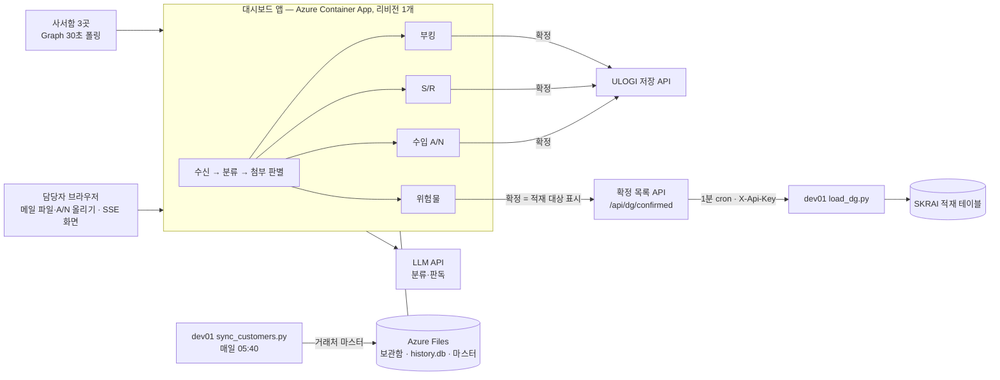
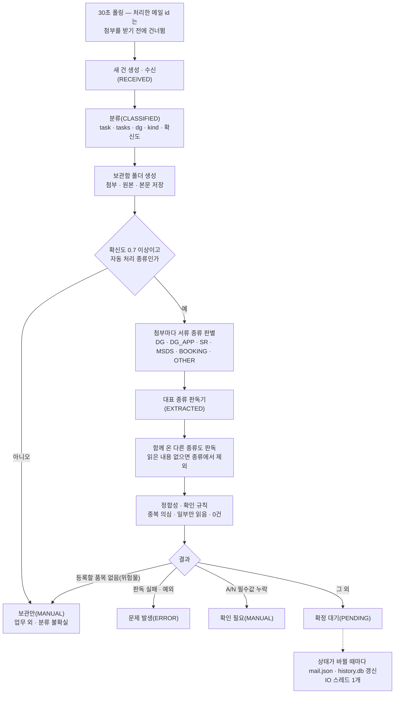
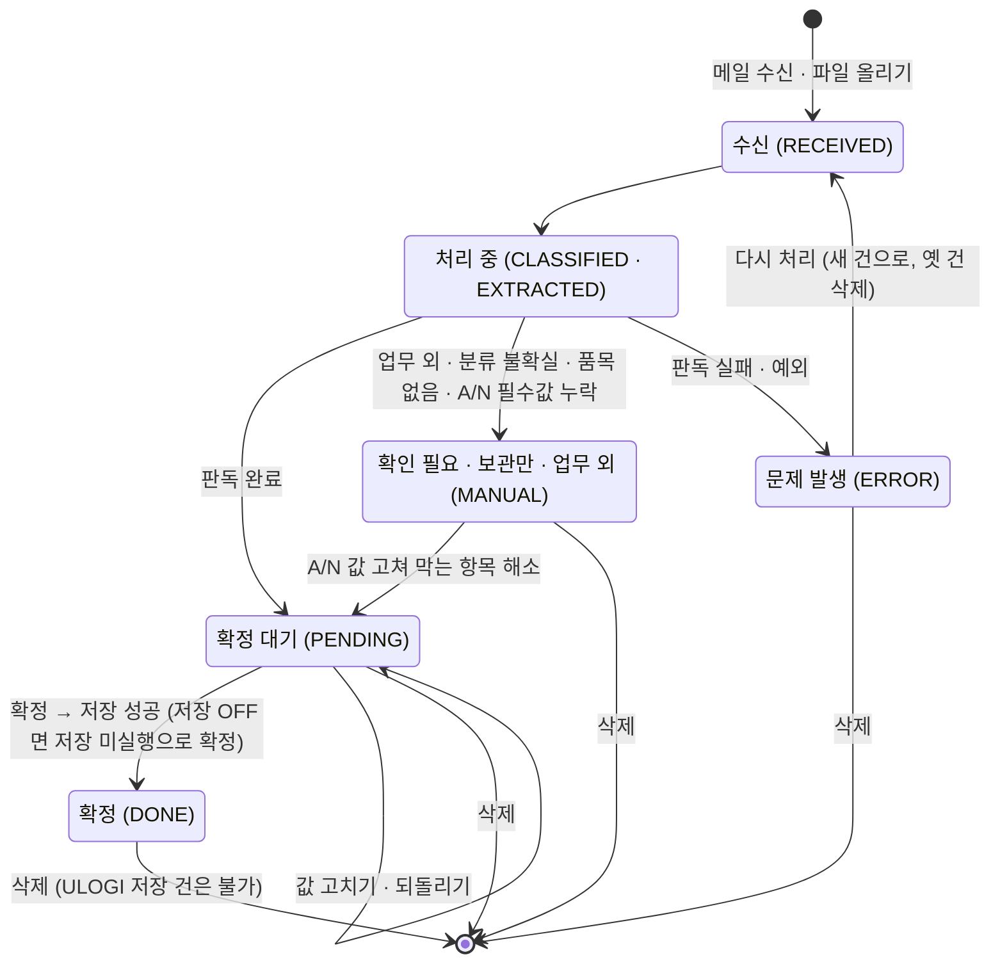
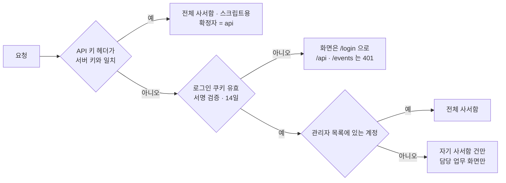

# 공통 구조·운영 — 수신부터 확정·보관·배포까지

- 대상: SANEI(일본사무소) 메일 자동처리 시스템의 **공통 뼈대** — 메일 수신·분류·첨부 판별·화면 상태·확정/수정/삭제 API·보관함·복원·인증·배포·배치. 모듈별 상세(부킹·S/R·위험물·수입 A/N)는 각 페이지에서 다룹니다.
- 읽는 분: 장금상선 전산팀(후임·운영 담당), 연동 상대(유로지·포털 담당)
- 비밀값·접속 정보는 적지 않습니다. 비밀·환경변수·리소스는 **이름과 역할**만 씁니다.

## 1. 목적

- 사서함에 온 메일을 30초마다 가져와 **부킹 의뢰 / 선적서류(S/R) / 위험물 서류 / 수입 A/N** 으로 분류하고 첨부(PDF·엑셀·스캔)를 읽어 ULOGI·포털에 넣을 값을 화면에 올립니다.
- **저장은 사람이 [확정] 을 눌러야만** 일어납니다. 추측 금지 — 값이 애매하면 채우지 않고 "확인 필요" 로 올립니다.
- 사서함 = 로그인 계정. **각자 자기 사서함 메일만** 보고 확정합니다(통계·보관도 사서함별).

## 2. 구성도와 구성 요소

| 요소 | 역할 | 어디에 |
|---|---|---|
| 대시보드 앱 (`mail_pipeline/status_app.py`, FastAPI) | 사서함 폴링, 분류·판독 파이프라인(`process`), 화면·API, 보관·복원·통계 | Azure Container App (단일 리비전) |
| 파이프라인 (`mail_pipeline/pipeline.py`) | 메일 소스(Graph·올린 파일), 분류(`CLASSIFY`), 첨부 종류 판별(`attachment_kind`), 모듈별 판독기, 확인 규칙 | 앱 안 |
| 모듈 4개 | 부킹(`BOOKING`) · S/R(`SR`) · 위험물(`DG_NOTICE`) · 수입 A/N(`AN`, `mail_pipeline/an.py`) | 앱 안 |
| ULOGI 클라이언트 (`mail_pipeline/ulogi.py`) | 확정 시 저장, 중복 가드, 추측 코드 제거 | 앱 안 → 유로지 API |
| 보관함·이력 | `archive/` 폴더, `history.db`(SQLite), `.mail_seen.json`, `masters/` | Azure Files (`DATA_DIR` 마운트) |
| LLM API | 분류(빠른 모델)·판독(정확도 모델). 모델명은 `MODEL`·`CLASSIFY_MODEL` 로 지정 | 외부 |
| 마스터 동기화 (`tools/sync_customers.py`) | 거래처 마스터 → `masters/customers.json`. 앱은 파일이 바뀌면 재시작 없이 다시 읽음 | dev01 cron |
| 위험물 적재 (`tools/load_dg.py`) | 확정된 위험물 건을 SKRAI 적재 테이블로 | dev01 cron |
| 화면 (`mail_pipeline/static/`) | 현황 · 위험물 · 수입 A/N · 통계 · 서류 뷰어 · 한→일 문구 변환(`msgs.js`) | 앱 안 |

## 3. 사서함과 담당 역할

- 사서함마다 담당 업무가 다릅니다 — 환경변수 `MAILBOX_TASKS` (계정별 담당 종류 목록). 적지 않은 계정은 전부 담당합니다.
- 담당하지 않는 업무는 화면·통계에서 보이지 않습니다(데이터는 그대로). 담당 외 화면으로 들어가면 자기 첫 화면으로 돌려보냅니다(`gate`·`home_of`).
- 계정이 `AN` 만 담당하면 Graph 감시에서 빠집니다(화면에 올린 서류만 처리). A/N 건은 처리 현황(`/`)에는 나오지 않고 전용 화면(`/an`)에만 나옵니다.
- 사서함 접근은 Graph 앱 + Exchange ApplicationAccessPolicy(사서함별). 정책은 실제 반영까지 약 2시간 걸릴 수 있습니다(반영 전에는 403).

| 사서함 (역할명) | 담당 (`MAILBOX_TASKS`) | 첫 화면 |
|---|---|---|
| 산에이 부킹·S/R·A/N 사서함 | `BOOKING`, `SR`, `AN` | `/` (처리 현황) |
| 도쿄 위험물 사서함 | `DG_NOTICE` | `/dg` |
| 흥아 위험물 사서함 | `DG_NOTICE` | `/dg` |

## 4. 메일 1통 처리 흐름

- **중복 수신 차단**: 읽음 표시 권한이 없어 읽음 처리를 못 합니다 → 처리한 메일 id 를 `.mail_seen.json` 에 기록하고 다음 폴링은 첨부를 받기 전에 그 id 를 건너뜁니다. **이 기록을 지우면 같은 메일을 다시 받아옵니다.** 기록은 보관함에 폴더가 남은 뒤에만 파일에 적습니다(처리 도중 죽으면 다음 기동에 다시 받음).
- **올린 파일**: `.msg/.eml` 을 화면에 올리면 올린 사람의 사서함 건으로 처리합니다. 같은 파일(Message-ID·내용 해시)이 지금 목록에 있으면 처리하지 않습니다.
- 병렬 워커 `WORKERS` 개 — 느린 S/R 판독이 부킹 메일을 막지 않게 합니다. 받은 시각은 `TZ` 기준(일본 시간)입니다.
- 보관함(SMB) 쓰기는 **IO 스레드 1개**에서만 합니다 — 이벤트 루프에서 쓰면 Liveness 프로브가 실패해 재시작 루프에 빠집니다.

## 5. 분류와 첨부 판별 규칙

| 분류 (`CLASSIFY`) | 뜻 |
|---|---|
| `SR` | 선적 서류 송부·확인 요청 (ACL 정보 · B/L Instructions · Dock Receipt · S/R) |
| `BOOKING` | 예약(부킹) 의뢰 |
| `AN` | 수입 화물 도착통지서 (청구서가 같이 와도 A/N) |
| `DG_NOTICE` | 위험물 서류만 보내온 메일 |
| `OTHER` | 그 외(문의·안내·자동회신) → 담당자 직접 처리 |

- 분류는 **제목이 아니라 "무엇을 해달라는 메일인지 + 첨부가 어떤 서류인지"** 로 합니다. 대표 종류 `task` 1개와 실제 들어 있는 종류 `tasks` 전부, 위험물 여부 `dg`, 신규/정정 `kind`, 확신도를 받습니다. 확신도 0.7 미만이면 "분류 불확실" 로 보관만 합니다.
- **첨부를 먼저 읽고 판정**: 첨부마다 종류(`ATT_KIND`: `DG` 신고서류 / `DG_APP` 신청서 / `SR` / `MSDS` / `BOOKING` / `OTHER` 참고자료)를 판별해 각 판독기로 보냅니다. 텍스트가 있으면 규칙으로, 스캔본은 첫 장 이미지로 빠른 모델에 묻습니다. SDS·적재 가부 목록은 신고 서류가 아닙니다.
- 한 메일에 여러 종류가 오면 **모두 처리해 각 화면에 올립니다**. 분류는 됐는데 읽은 내용이 없으면 종류 표시에서 뺍니다.
- **정합성 규칙**: 분류가 S/R 인데 B/L 0건 + 위험물만 읽혔으면 위험물 건으로 바꿉니다(`demote_sr_to_dg`, 보관 폴더도 이동). 읽어낸 게 0건이면 어떤 종류든 "이상 없음" 이 될 수 없고 확정이 막힙니다. 위험물만 맡는 사서함에서는 첨부가 위험물 신고 서류면 분류가 S/R 이어도 위험물로 처리합니다.
- **날짜 상식 검사**(부킹·S/R 공통): 출항일이 1년 이상 뒤이거나 형식이 이상하면 확인 필요. 지난 출항일은 부킹이면 확인 필요, S/R 은 참고. 도착일 < 출항일이면 원문 확인. 연도 없는 날짜는 서버 기준 올해로 읽습니다(`fill_year`).
- **중복 의심**: 같은 화주·화물이 30일 안에 다시 오면 "중복 의심"(확정 전 확인). 정정본(`REVISION`)이면 주의로만 표시합니다.

## 6. 건 상태와 전이

- `MANUAL` 하나에 "확인 필요(A/N)·보관만(위험물 품목 없음)·업무 외·분류 불확실" 이 메모(`note`)로 구분돼 들어갑니다. 화면 집계는 `GRP` 로 묶습니다(처리 중 / 확정 대기 / 확정 / 수동 / 오류).
- **확정이 막히는 조건**(`blockers`): 확인 목록의 `ERROR` 항목 + 읽어낸 건이 0건. 부킹·S/R·위험물은 막는 항목이 있어도 **확정 대기에 머물고** 확정할 때 409 로 한 번 더 묻습니다(`force=1` 로 재요청, ⚑ 표시). A/N 만 확인 필요(`MANUAL`)로 내려갑니다.
- **저장 실패**는 `DONE` 으로 넘기지 않고 확정 대기로 되돌립니다("저장 실패 + 이유"). 자동 재시도는 없습니다 — 담당자가 다시 확정합니다. 이미 저장된 건을 다시 확정하면 저장 없이 `DONE` 만 찍습니다.
- **수정**(`✎ 값 고치기`): `EDIT_STAGES`(확정 대기·확인 필요)이고 **ULOGI 에 저장되지 않은 건**만. 처음 판독값은 `payload_orig` 에 한 번만 남겨 `되돌리기` 로 복구합니다. 고치면 확인 규칙을 그 자리에서 다시 돌립니다(`_apply_checks`). 값과 무관한 지적(`KEEP_CHECKS`: 중복 의심·거의 같은 메일·서류가 길어)은 그대로 둡니다.
- **삭제**: 본인 사서함 건만. 화면·보관 폴더·통계 이력이 함께 지워지고 되돌릴 수 없습니다. 사서함 메일은 "처리한 메일" 기록을 그대로 둬 다시 받아오지 않고 올린 파일만 재업로드할 수 있습니다.
- **다시 처리**(`retry`): 문제 발생 건만. 사서함에서 그 메일을 **메일 id 로 다시 받아** 새 건으로 처리하고 옛 건을 지웁니다. 올린 파일은 원문이 사서함에 없으니 지우고 다시 올립니다.
- 위험물 확정은 포털·ULOGI 저장 없이 **적재 대상 표시**만 합니다(`done_ts`·`done_by`). 복원 범위(`RESTORE_DAYS`)를 지난 건은 확정할 수 없습니다(409).

| 경로 | 메서드 | 누가 | 결과 코드 |
|---|---|---|---|
| `/api/approve/{id}` (`force`, `allow_dup`) | POST | 자기 사서함 건 · 관리자 · API 키 | 200 확정 / 400 확정 대기 아님 / 409 `blockers`(→ `force=1`) · 409 `dup` 같은 화물 부킹(→ `allow_dup=1`) · 409 복원 범위 밖 / 502 저장 실패 |
| `/api/approve_many` (`{ids}`, `force`) | POST | 같음 | 200 `{n, blocked, failed, skipped}` — 막힌 건·확정 대기 아닌 건은 건너뛰고 돌려줌, 중복은 묻지 않고 실패로 |
| `/api/item/{id}/edit` (`{payload}`) | POST | 같음 | 200 `{checks, blockers, edited}` / 400 payload 없음 / 404 / 409 저장된 건·수정 불가 상태 |
| `/api/item/{id}/edit/reset` | POST | 같음 | 200 / 404 / 409 수정한 적 없음·저장된 건 |
| `/api/item/{id}` | DELETE | 같음 | 200 / 404 / 409 ULOGI 저장 건(`ref` 반환) |
| `/api/item/{id}/retry` | POST | 같음 | 200 `{id}` 새 건 / 404 / 409 문제 발생 아님·저장된 건·올린 파일·사서함 연결 없음 / 502 원문 못 받음 |
| `/api/upload` · `/api/an/upload` (파일) | POST | 로그인 계정(올린 사람 사서함으로 기록) | 200 `{queued, items, failed, duplicate}` |
| `/api/dg/confirmed?since=` | GET | API 키·관리자 = 전체, 계정 = 자기 사서함 | 200 확정(DONE)된 위험물 건 목록(`done_ts` 오름차순) |

- 읽기 API: `/api/state`(목록 스냅샷) · `/events`(SSE, 사서함별 스냅샷 + 15초 keepalive) · `/api/item/{id}`(+ `/attachments` · `/mail` · `/raw` · `/att/{idx}`) · `/api/stats?days=` · `/api/archive` · `/api/dg`(+ 엑셀·zip) · `/api/an`. 목록 스트림은 무거운 칸(`HEAVY`)을 빼고 상세는 `/api/item/{id}` 로 받습니다.

## 7. 보관함·이력·복원

- 폴더: `archive/<부킹|SR|위험물|기타|수입AN>/연/월/<일시_id>/` — 첨부 + `original.msg` + `body.txt`/`body.html` + **`mail.json`**(판독 결과·확인 목록·상태, 상태가 바뀔 때마다 갱신). 분류 직후 만들어지고 종류가 바뀌면 폴더도 옮깁니다.
- 보관 일수: `archive_policy.json`(카테고리별 `retention_days`, 통계 이력 `history_days`). 파일이 없으면 `DEFAULT_POLICY` 로 생성하고 값만 바꾸면 다음 정리부터 적용됩니다. 하루 1회(기동 시 포함) 지난 폴더를 지우고 빈 월/연 폴더를 정리합니다. 기본 정책에는 `수입AN` 항목이 없어 넣기 전까지는 자동 정리 대상이 아닙니다.
- 이력 `history.db`(SQLite, 테이블 `items`): 통계용. 메일 1통 = 1행(사서함·종류·상태·확정 시각 등). SQLite 를 Azure Files 위에 두므로 마운트에 `nobrl` 이 필요합니다. `write_later` 가 `mail.json` 과 함께 IO 스레드에서 씁니다.
- **재시작 복원**(`restore_items`): 보관함의 `mail.json` 에서 최근 `RESTORE_DAYS`(기본 30일)를 되살립니다. 지금 쓰지 않는 사서함 기록은 복원하지 않고 같은 메일이 여러 폴더면 가장 최근 1건만 둡니다.
- 복원 시 확인 목록은 저장 당시가 아니라 **현재 규칙으로 다시 계산**합니다. 확정 대기·확인 필요이고 저장 안 된 위험물 품목에는 지금의 자동 보정 규칙을 다시 적용합니다(`dg_renorm`) — 확정·저장·문제 발생 건과 **담당자가 화면에서 고친 건은 건드리지 않습니다**. 여러 번 돌려도 바뀌는 것이 없습니다.
- 기동 직후 보관함에 없는 이력을 통계에서 빼고 같은 메일이 중복 저장된 폴더를 정리합니다(`dedupe_archive`). 보관함 용량 집계는 느려서 10분 기억합니다.

## 8. 인증·권한

- 로그인 계정 = 사서함. 쿠키는 서버의 서명키로 HMAC 서명합니다. 그 키를 바꾸면 모든 사용자가 다시 로그인합니다.
- `_scope`: 관리자 목록에 있는 계정·API 키는 전체(scope 없음), 그 외는 자기 사서함. `visible` 이 모든 목록·상세·확정·삭제에 적용됩니다.
- API 키는 전 사서함을 읽으므로 **적재·점검 스크립트에서만** 씁니다.
- `/login` · `/logout` · `/static/` 만 인증 없이 열립니다(헬스체크도 `/login`).

## 9. 운영

- **배포**: 코드 저장소 `main` 푸시 = 운영 배포. GitHub Actions `deploy` 워크플로 — `Azure login (OIDC)` → `Build & push image to ACR` → `Update Container App`. 새 리비전이 Healthy 되는 데 1~2분. `.md`·`tools/`·사무소 자료 폴더 변경은 배포를 일으키지 않습니다(dev01 cron 스크립트는 별도).
- **리비전·스케일**: 단일 리비전, `minReplicas`=`maxReplicas`=1 — 폴링이 멈추면 안 되고 **2개면 같은 메일을 둘이 처리**합니다. 같은 사서함을 보는 인스턴스는 어디에도 하나만 둡니다.
- **저장소**: Azure Files 공유를 `DATA_DIR` 에 마운트(`nobrl` 필수 — 없으면 `history.db` 가 0바이트가 됩니다).
- **프로브**: Startup·Liveness 모두 `/login`. 판독 중에는 응답이 몇 초 늦을 수 있어 타임아웃을 넉넉히 둡니다(1초면 재시작 루프).
- **비밀값**(LLM API 키 · Graph 앱 비밀 · 사서함 비밀번호 · ULOGI 비밀번호 · 쿠키 서명키 · API 키)은 Container App secret 으로만 두고 코드·로그·문서에 쓰지 않습니다. Graph 앱 비밀은 만료 30일 전부터 화면에 경고가 뜹니다.
- **저장 스위치**: 운영 서버는 부킹·S/R·A/N 저장이 모두 켜져 있습니다. 위험물은 저장 API 가 없어 엑셀 내려받기 + 적재 대상 표시입니다.

| dev01 cron | 주기 | 하는 일 | 종료코드 |
|---|---|---|---|
| `tools/sync_customers.py` | 매일 05:40 | 거래처 마스터 SELECT 1회 → `customers.json` → Azure Files `masters/`. 운영본과 같으면 올리지 않음. 직전 파일 백업 14개 | 0 정상 · 1 조회 실패 · 2 검사 불통과 · 3 Azure 실패 · 4 다른 실행 중 |
| `tools/load_dg.py` | 1분마다 | 확정 목록 API 를 X-Api-Key 로 읽어 새로 확정된 위험물 건만 SKRAI 적재. 새 건 없으면 DB 미접속, lock 으로 중복 방지, 상태 파일로 멱등 | 0 정상 · 1 조회/DB 실패 또는 일부 건 실패 · 3 토큰 못 받음 · 4 다른 실행 중 |

- 로그·상태 파일은 운영 서버 로그 폴더에 둡니다: `sync_customers.log`(실행당 한 줄) · `load_dg.log`(실행당 한 줄 + 건별 경고) · `load_dg_state.json` · lock 파일. 비밀값은 화면·로그에 찍지 않습니다.
- **로컬 실행**: Graph 테넌트 변수를 비우면 사서함 폴링을 하지 않고 올린 파일만 처리합니다. **실 자격증명으로 로컬을 켜면 운영과 같은 메일을 둘 다 처리**하므로 운영은 Azure 하나만.

## 10. 화면 문구 (한→일)

- 서버는 확인할 점·자동 보정·처리 메모·처리 기록을 **한국어로 기록**합니다. 화면 언어가 일본어면 `mail_pipeline/static/msgs.js` 가 통째로 번역합니다(`Msg.t(text, lang)`) — 정확히 일치하는 문구 표와 규칙이 **한 곳**에 있습니다.
- 서버 문구를 새로 만들면 `msgs.js` 에도 짝을 넣습니다. 적재 스크립트도 이 규칙 중 해당하는 것만 옮겨 비고를 일본어로 씁니다.

---

*문의: 장금상선 전산팀*
