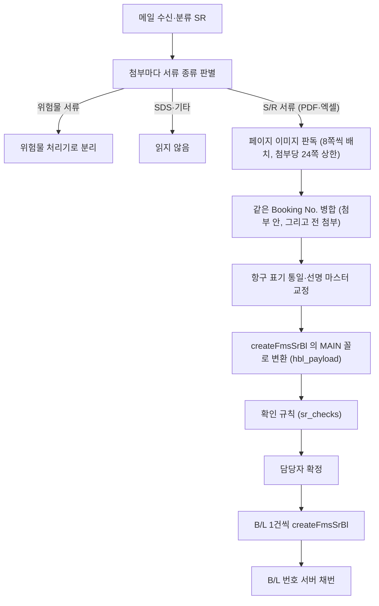
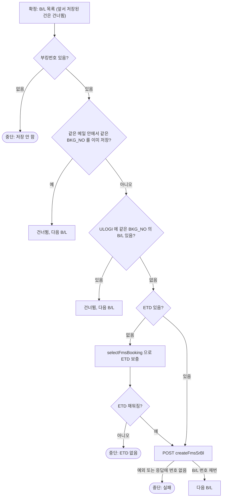

# 수출 S/R → ULOGI B/L 생성 명세

- 대상: 대시보드 「S/R」 화면에서 담당자가 **[확정]** 을 누른 선적서류 메일 1통 (안에 든 B/L n건)
- 읽는 분: 유로지(ULOGI) 개발 담당, 장금상선 전산팀

## 1. 목적·대상

- 사서함으로 온 **선적서류(S/R) 메일** — 첨부가 ACL情報(コンテナ船本情報) / B/L Instructions / Dock Receipt / 船積依頼書 / SHIPPING INSTRUCTION — 를 읽어 **B/L 1건 = ULOGI 수출 B/L 1건** 으로 `POST /api/fms/booking/createFmsSrBl` 에 보냅니다. 유로지가 S/R 용으로 둔 B/L 생성 API 입니다.
- 저장은 담당자가 [확정] 을 누른 순간에만 POST 합니다. 운영 서버에는 S/R 저장이 켜져 있습니다.
- body 는 `{"MAIN": {…}}` 하나이고 MAIN 의 칸은 §3 의 22개뿐입니다. 숫자·날짜도 전부 문자열로 보냅니다.

## 2. 흐름



- **첨부 종류 판별**(`attachment_kind`): 파일 단위로 판별합니다. 텍스트 PDF·엑셀은 규칙(정규식)으로, 스캔본은 첫 장 이미지로 빠른 모델에 묻습니다. PDF 는 위험물(DG)·SDS·기타가 아니면 B/L 판독에 쓰고 엑셀(Dock Receipt 등)은 S/R 로 판별된 것만 셀 텍스트로 판독합니다. 위험물 서류는 같은 메일 안에서 위험물 항목으로 따로 읽어 위험물 화면에 올립니다.
- **판독**(`SR_STRUCT`): 페이지 이미지(150dpi)를 8쪽(`SR_BATCH`) 단위로 나눠 보내고 첨부당 24쪽(`SR_MAX_PAGES`)까지만 읽습니다. 메일 제목·본문 앞부분도 함께 줘 제목의 "ETD9/8" 같은 날짜를 씁니다. 연도가 없으면 서버 기준 올해로 읽습니다. 읽는 항목: booking_no, shipper/consignee/notify 회사명과 각 주소(shipper_addr/consignee_addr/notify_addr), vessel, voyage, pol, pod, etd, eta, package_qty, package_unit, gross_kg, cbm, commodity(품명), marks, description, source_pages.
- **병합**(`merge_sr_items`): Booking No. 를 영숫자만 남겨 대문자로 비교합니다. 먼저 읽힌 값을 두고 빈 칸만 보충하며 source_pages 는 합집합. 부킹번호 없는 항목은 병합하지 않습니다. 첨부 안에서 한 번, 전 첨부를 통틀어 한 번 더 합칩니다.
- **정규화**(`normalize_ports_vessel`): 항구 표기 통일(한자·약칭·"KOBE, JAPAN" → 영문 도시명), 선명은 MDM_VESSEL 목록과 대조해 오타를 교정(유사도 0.82 이상). 바꾼 내용은 `_auto` 로 화면에 남습니다.

## 3. 보내는 MAIN (22칸)

| 칸 | 출처 | 비고 |
|---|---|---|
| BKG_NO | booking_no (ACL「Booking No.」란 우선) | 읽은 그대로. 규칙은 §6 |
| SHP_NM · SHP_ADDR | shipper / shipper_addr | 회사명과 주소를 따로 읽습니다. 거래처 코드는 보내지 않습니다 |
| CNE_NM · CNE_ADDR | consignee / consignee_addr | 같음 |
| NFY_NM · NFY_ADDR | notify / notify_addr | notify 가 없으면 둘 다 `SAME AS CONSIGNEE` |
| VSL_NM | vessel (마스터로 오타를 고친 이름) | 선박 코드는 보내지 않습니다 |
| VOY_NO | voyage | `V-`·`VOY.` 접두 제거 |
| ETD_DT | etd | `YYYY-MM-DD`. 없으면 §6 |
| POL_CD · POL_NM | pol → MDM_PORT | 5자리 코드 + 마스터 항구명(`OSAKA, JAPAN` 꼴) |
| POD_CD · POD_NM | pod → MDM_PORT | 같음 |
| CMDT_NM | commodity | 품명. 못 읽었으면 description 의 첫 줄. 200자까지 |
| PKG_QTY | package_qty | 문자열 숫자(`"6"`) |
| PKG_UNIT_CD · PKG_UNIT_NM | package_unit → MDM_PKG_UNIT | 복수형·약칭(PLT·CTN 등) 흡수. 마스터에 없으면 코드는 빈 문자열, 이름만 |
| GROSS_WT · CBM_WT | gross_kg / cbm | 문자열 숫자(`"4300"`, `"6.5"`). 정수는 `.0` 없이 |
| HBL_MARK | marks | 없으면 `N/M`. 2,000자까지 |
| HBL_DESC | description | 없으면 품명. 4,000자까지 |

- 값이 없는 칸은 키를 빼지 않고 빈 문자열 `""` 로 보냅니다. 22개 키는 항상 다 있습니다.
- 이 22칸 밖의 값(거래처·선박 코드, LOAD_TP, 선사·파트너·발행지, 운임조건, 컨테이너, ETA 등)은 보내지 않습니다.
- B/L 번호는 서버 채번입니다. 응답의 `data.HBL_NO` 를 저장 번호로 기록하고 없으면 `data.BL_NO`, `data.JOB_NO`, 최상위의 같은 키 순으로 찾습니다. 어느 것도 없으면 그 B/L 은 화면에 저장 실패로 돌아갑니다(§6).

예시 — 값은 전부 가짜입니다.

```json
{
  "MAIN": {
    "BKG_NO": "IMBL261117001",
    "SHP_NM": "SAMPLE SHIPPER CO., LTD.",
    "SHP_ADDR": "1-2-3 SAMPLE-CHO, IMABARI, EHIME, JAPAN",
    "CNE_NM": "SAMPLE CONSIGNEE CO., LTD.",
    "CNE_ADDR": "123, SAMPLE-RO, BUSAN, KOREA",
    "NFY_NM": "SAME AS CONSIGNEE",
    "NFY_ADDR": "SAME AS CONSIGNEE",
    "VSL_NM": "SAMPLE VESSEL",
    "VOY_NO": "2646W",
    "ETD_DT": "2026-11-17",
    "POL_CD": "JPIMB", "POL_NM": "IMABARI, JAPAN",
    "POD_CD": "KRPUS", "POD_NM": "BUSAN, KOREA",
    "CMDT_NM": "ALUMINUM OXIDE (HS CODE: 2818.20)",
    "PKG_QTY": "6",
    "PKG_UNIT_CD": "PT", "PKG_UNIT_NM": "PALLETS",
    "GROSS_WT": "4300", "CBM_WT": "6",
    "HBL_MARK": "N/M",
    "HBL_DESC": "ALUMINUM OXIDE (HS CODE: 2818.20)\n6 PALLETS"
  }
}
```

## 4. 마스터로 붙이는 코드

ULOGI 마스터(MDM 테이블)를 JSON 으로 가공해 서버에 두고 읽습니다. S/R 에서는 거래처 마스터를 쓰지 않습니다(코드를 보내지 않으므로).

| 마스터 | 출처 | 쓰는 곳 |
|---|---|---|
| ports.json | JPSAL.MDM_PORT (7,244건) | POL/POD 코드·이름. 5글자 항구명(OSAKA·BUSAN)이 코드처럼 보이므로 코드 목록에 있는지로 판별 |
| vessels.json | JPSAL.MDM_VESSEL | 선명 오타 교정(이름만 씀) |
| pkg_units.json | JPSAL.MDM_PKG_UNIT | PKG_UNIT_CD |

## 5. 기본값·파생값

| 칸 | 값 | 언제 |
|---|---|---|
| NFY_NM · NFY_ADDR | `SAME AS CONSIGNEE` | notify 가 없을 때 |
| HBL_MARK | `N/M` | marks 가 없을 때 |
| CMDT_NM | description 의 첫 줄 | commodity 를 못 읽었을 때 |
| HBL_DESC | = CMDT_NM | description 이 없을 때 |
| ETD_DT | `YYYY-MM-DD` | 서류의 어떤 표기든 이 꼴로 바꿉니다 |
| PKG_QTY · GROSS_WT · CBM_WT | 문자열 | `"6"`, `"4300"`, `"6.5"` |

## 6. 저장 전 판정



- **부킹번호**: ACL情報의 「Booking No.」란 번호가 곧 ULOGI(산에이) 부킹번호입니다 — 형식 「선적항 3자리 + L + 출항일 YYMMDD + 순번」. 실제 ULOGI 등록 건과 대조해 확인했습니다. 저장 때 그 번호가 FMS_BKG 에 있는지는 **확인하지 않습니다**(ETD 가 없을 때만 부킹을 조회).
- 부킹번호 없는 B/L 을 저장하면 어느 부킹 건인지 모르는 기록이 남으므로 저장하지 않고 중단합니다 → 담당자가 서류에서 Booking No. 확인.
- **기존 B/L 확인**(`existing_hbl`): `selectFmsHouseblList`(SEARCH.CORP_CD) 로 전체 목록을 받아 BKG_NO 별로 묶고 5분 캐시합니다. 사무소가 직접 등록해 둔 건을 두 번 넣지 않기 위한 것이며 **조회가 실패하면 막지 않습니다**(저장은 담당자가 확정한 행동). POST 를 한 번이라도 보냈으면 캐시를 버려, 응답을 못 읽은 건을 다시 확정해도 목록으로 걸러집니다.
- **ETD 보충**: B/L 번호가 ETD 로 채번되므로, 없으면 `selectFmsBooking`(SEARCH.BKG_NO) 의 ETD_DT 를 `YYYY-MM-DD` 로 바꿔 ETD_DT 에 넣습니다. 그래도 없으면 여기서 멈춥니다.
- **건너뜀 vs 중단**: 건너뜀은 그 B/L 만 넘기고 계속합니다. 중단은 그 B/L 부터 멈추되 앞서 채번된 번호 목록(`save_nos`)을 남겨, 담당자가 다시 확정하면 **이어서** 저장합니다(앞 건을 두 번 저장하지 않음). 화면에는 "저장 실패 + 이유" 가 뜨고 확정 대기로 돌아갑니다. 자동 재시도는 없습니다.

## 7. 읽지만 보내지 않는 것 · 읽지 않는 것

- **eta**: 날짜 확인 규칙(§8)에만 쓰고 보내지 않습니다.
- **컨테이너**(번호·씰·타입)·**운임조건**: 읽지 않습니다. MAIN 에 칸도 없습니다.
- **거래처 코드**: 회사명·주소만 보냅니다. 코드는 유로지 쪽에서 붙입니다.

## 8. 확인 규칙

| 등급 | 조건 | 비고 |
|---|---|---|
| ERROR | S/R 서류에서 B/L 을 읽지 못함 (0건) | 확정 막음 |
| ERROR | 출항일(ETD) 없는 B/L | 채번 불가 |
| ERROR | 부킹번호를 읽지 못한 B/L | 몇 번째인지 표시 |
| ERROR | 출항일이 1년 이상 뒤 · 형식 이상 | 연도 확인 |
| ALERT | 출항일이 이미 지남(3일 넘게) | S/R 은 배가 떠난 뒤 서류가 오기도 해 참고만 (부킹은 ERROR) |
| ALERT | 도착일 < 출항일 | 원문 확인 |
| ERROR | 서류가 길어 일부만 읽음 (24쪽 초과) | `cut_check` |
| ERROR / ALERT | 중복 의심 — 30일 안에 받은 같은 종류 메일과 부킹번호가 겹침 (같은 보낸이 + 같은 제목·첨부도 해당) | 정정본(REVISION)이면 ALERT |
| ALERT | 함께 온 위험물 서류 판독 실패 | B/L 은 읽었으니 확정은 막지 않음 |
| ERROR | 읽어낸 건이 0 인데 지적이 없음 | 종류와 내용이 안 맞는 신호 |

- 같은 지적은 B/L 번호를 모아 한 줄로 냅니다. ERROR 가 하나라도 있으면 확정을 막습니다(§9).
- B/L 0건 + 위험물 서류만 읽힌 메일은 위험물 건으로 바꿉니다(`demote_sr_to_dg`). 재시작 복원 때는 저장 당시가 아니라 현재 규칙으로 다시 계산합니다.

## 9. 확정·수정 규칙

- ERROR 가 있으면 409 → 화면이 한 번 더 묻고 `force=1` 로 재요청합니다. 저장 실패 → 확정 대기(PENDING)로 돌아오고 `save_error` 가 보입니다. 성공 → DONE, 채번된 B/L 번호 목록을 기록합니다. 건너뛴 B/L 은 처리 기록에 남깁니다.
- 이미 저장된 건(`saved` + `save_ref`)을 다시 확정하면 POST 없이 DONE 으로만 넘깁니다.
- **값 고치기**(`/api/item/{id}/edit`): 확정 대기·확인 필요 상태이고 **ULOGI 에 저장되지 않은 건**만. 화면에 보이는 칸이 곧 MAIN 의 22칸입니다. 고치면 BKG_NO·ETD_DT 를 되읽어 `sr_checks` 를 다시 돌리고(eta 는 처음 판독값), 처음 판독값은 `payload_orig` 로 남겨 되돌릴 수 있습니다. 중복 의심·일부만 읽음 지적은 고쳐도 그대로 남습니다. S/R 은 막는 항목이 있어도 확정 대기에 머뭅니다.
- 저장된 건은 수정·삭제 모두 불가(ULOGI 기록과 어긋나지 않게).
- 자동 확정(`AUTO_APPROVE`)은 실저장이 켜져 있으면 동작하지 않습니다 — 저장은 사람이 누를 때만.

## 10. 한계

- 주소·품명은 서류에 적힌 그대로 읽습니다. 여러 줄 주소는 줄바꿈을 그대로 둡니다. 서류에 없으면 빈 문자열입니다.
- 부킹번호가 FMS_BKG 에 없는 경우: 서류에 ETD 가 있으면 그대로 저장을 시도합니다(결과는 서버 응답에 따름). ETD 도 없을 때만 부킹 조회가 비어 "ETD 없음" 중단으로 드러납니다.
- 저장 뒤 재조회로 대조하지 않습니다(응답의 채번 번호만 기록). 부킹 저장과 다른 점입니다.
- 응답에서 번호를 찾는 키는 HBL_NO → BL_NO → JOB_NO 순입니다. 다른 키로 돌아오면 ULOGI 에는 들어갔어도 화면에는 저장 실패로 보입니다.
- 연도 없는 날짜는 서버 기준 올해로 읽습니다. 첨부당 24쪽까지만 읽고 넘으면 "일부만 읽음" 확인 필요로 올립니다.

---

*문의: 장금상선 전산팀*
