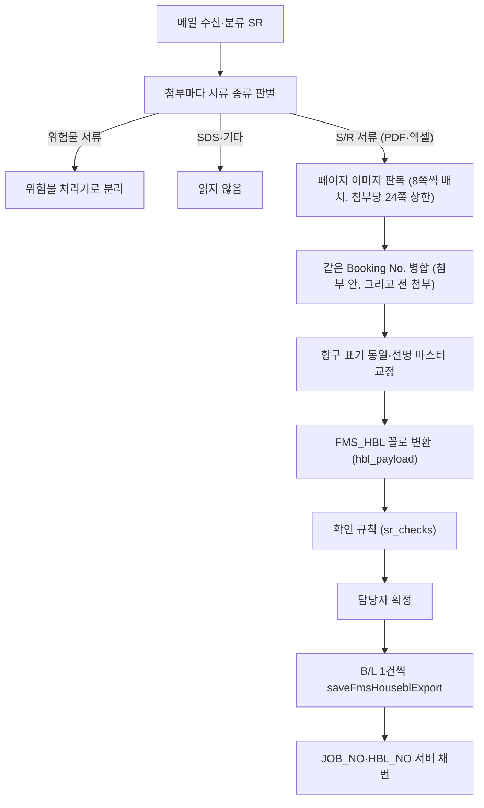
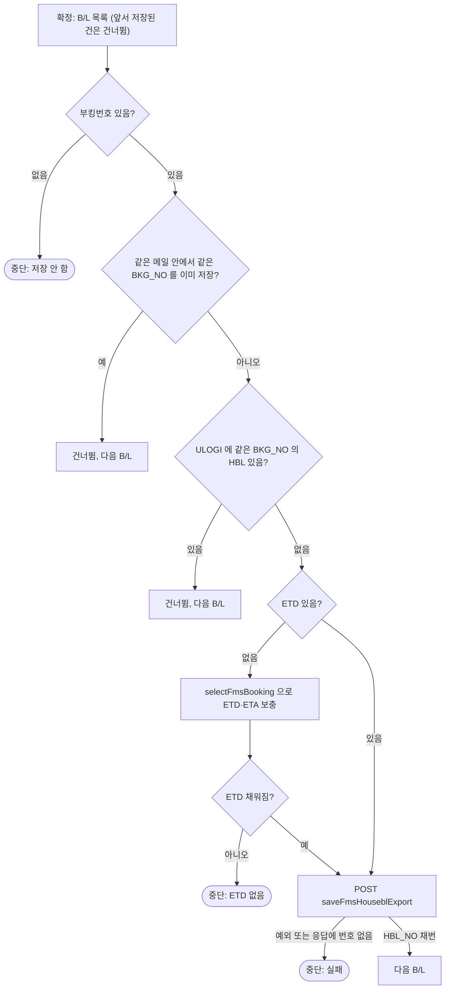
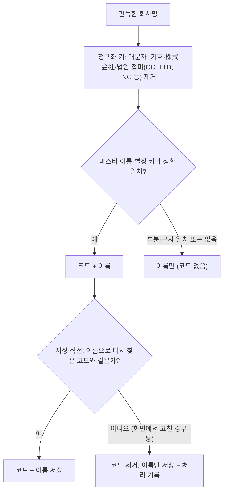

# 수출 S/R → ULOGI House B/L 저장 명세

- 대상: 대시보드 「S/R」 화면에서 담당자가 **[확정]** 을 누른 선적서류 메일 1통 (안에 든 B/L n건)
- 읽는 분: 유로지(ULOGI) 개발 담당, 장금상선 전산팀

## 1. 목적·대상

- 사서함으로 온 **선적서류(S/R) 메일** — 첨부가 ACL情報(コンテナ船本情報) / B/L Instructions / Dock Receipt / 船積依頼書 / SHIPPING INSTRUCTION — 를 읽어, **B/L 1건 = ULOGI 수출 House B/L 1건** 으로 `POST /api/fms/housebl/saveFmsHouseblExport` 에 저장합니다.
- 저장은 담당자가 [확정] 을 누른 순간에만 POST 합니다. 운영 서버에는 S/R 저장이 켜져 있습니다.
- 보내는 형식은 실계정에서 `saveFmsHouseblExport` 저장 → `selectFmsHouseblExport`(SEARCH.JOB_NO) 재조회 일치 → `deleteFmsHouseblExport` 삭제까지 확인한 **MAIN + CNTR_GRID + MAIN_EXPL** 입니다.

## 2. 흐름

- **첨부 종류 판별**(`attachment_kind`): 파일 단위로 판별합니다. 텍스트 PDF·엑셀은 규칙(정규식)으로, 스캔본은 첫 장 이미지로 빠른 모델에 묻습니다. PDF 는 위험물(DG)·SDS·기타가 아니면 B/L 판독에 쓰고, 엑셀(Dock Receipt 등)은 S/R 로 판별된 것만 셀 텍스트로 판독합니다. 위험물 서류는 같은 메일 안에서 위험물 항목으로 따로 읽어 위험물 화면에 올립니다.
- **판독**(`SR_STRUCT`): 페이지 이미지(150dpi)를 8쪽(`SR_BATCH`) 단위로 나눠 보내고, 첨부당 24쪽(`SR_MAX_PAGES`)까지만 읽습니다. 메일 제목·본문 앞부분도 함께 줘 제목의 "ETD9/8" 같은 날짜를 씁니다. 연도가 없으면 서버 기준 올해로 읽습니다. 읽는 항목: booking_no, shipper/consignee/notify(회사명만), vessel, voyage, pol, pod, etd, eta, package_qty, package_unit, gross_kg, cbm, marks, description, source_pages.
- **병합**(`merge_sr_items`): Booking No. 를 영숫자만 남겨 대문자로 비교합니다. 먼저 읽힌 값을 두고 빈 칸만 보충하며 source_pages 는 합집합. 부킹번호 없는 항목은 병합하지 않습니다. 첨부 안에서 한 번, 전 첨부를 통틀어 한 번 더 합칩니다.
- **정규화**(`normalize_ports_vessel`): 항구 표기 통일(한자·약칭·"KOBE, JAPAN" → 영문 도시명), 선명은 MDM_VESSEL 목록과 대조해 오타를 교정(유사도 0.82 이상). 바꾼 내용은 `_auto` 로 화면에 남습니다.

## 3. 판독 항목 → FMS_HBL 매핑

| 페이로드 칸 | 출처 | 비고 |
|---|---|---|
| BKG_NO | booking_no (ACL「Booking No.」란 우선) | 읽은 그대로. 규칙은 §7 |
| SHP_NM · SHP_CD | shipper → 거래처 마스터 | 코드는 정확 일치일 때만 (§8) |
| CNE_NM · CNE_CD | consignee → 거래처 마스터 | 같음 |
| NFY_NM · NFY_CD | notify → 거래처 마스터 | notify 없으면 NFY_NM = `SAME AS CONSIGNEE`, 코드 없음 |
| VSL_NM · VSL_CD | vessel(마스터 교정 후) → MDM_VESSEL 코드 | 마스터에 없으면 VSL_CD 없이 이름만 |
| VOY_NO | voyage | `V-`·`VOY.` 접두 제거 |
| POL_CD · POL_NM | pol → MDM_PORT | 5자리 코드 + 마스터 항구명(`OSAKA, JAPAN` 꼴) |
| POD_CD · POD_NM | pod → MDM_PORT | 같음 |
| POR_CD · POR_NM | = POL 코드 + `<도시> CFS` | 도시 = 마스터 항구명의 쉼표 앞 |
| DLV_CD · DLV_NM | = POD 코드 + `<도시> CFS` | 같음 |
| ETD_DT · ONBOARD_DT · ISSUE_DT | etd (YYYYMMDD) | 세 칸 모두 ETD. 없으면 §7 |
| PKG_QTY · PKG_UNIT_NM · PKG_UNIT_CD | package_qty / package_unit → MDM_PKG_UNIT | 복수형·약칭(PLT·CTN 등) 흡수. 마스터에 없으면 코드 없이 이름만 |
| GROSS_WT · CBM_WT | gross_kg / cbm | 숫자 |
| RTON_WT | max(CBM, G/W ÷ 1000) 소수 3자리 | 둘 다 없으면 없음 |
| MAIN_EXPL.HBL_MARK | marks | 없으면 `N/M`, 2,000자까지 |
| MAIN_EXPL.HBL_DESC | description | 없으면 빈 문자열, 4,000자까지 |
| CNTR_GRID | — | 항상 `[]` (§6) |

- 전송 body = `{"MAIN": …, "CNTR_GRID": [], "MAIN_EXPL": {"HBL_MARK": …, "HBL_DESC": …}}` 뿐입니다. `hbl_payload` 가 만드는 PARTY(SHP/CNE/NFY) 는 **보내지 않습니다**.
- MAIN 에서 값이 null·빈 문자열인 칸은 전송 직전 **키 자체를 뺍니다**. 그래서 HBL_NO(빈 값)·매칭 안 된 코드(VSL_CD·SHP_CD·PKG_UNIT_CD 등)·FRT_TERM_CD 는 body 에 없습니다. JOB_NO·HBL_NO 는 서버 채번이며, 응답 `data.HBL_NO`(없으면 `data.JOB_NO`) 를 저장 번호로 기록합니다.

## 4. 마스터로 붙이는 코드

ULOGI 마스터(MDM 테이블)를 JSON 으로 가공해 서버에 두고 읽습니다.

| 마스터 | 출처 | 쓰는 곳 |
|---|---|---|
| ports.json | JPSAL.MDM_PORT (7,244건) | POL/POD/POR/DLV 코드·이름. 5글자 항구명(OSAKA·BUSAN)이 코드처럼 보이므로 코드 목록에 있는지로 판별 |
| vessels.json | JPSAL.MDM_VESSEL | 선명 오타 교정, VSL_CD |
| pkg_units.json | JPSAL.MDM_PKG_UNIT | PKG_UNIT_CD |
| customers.json | JPSAL.MDM_CUSTOMER (이름·별칭·메일 도메인) | SHP/CNE/NFY 코드. 매일 05:40 동기화, 파일이 바뀌면 재시작 없이 다시 읽음 |

## 5. 고정·파생값

실제 등록된 FMS_HBL 행을 보고 맞춘 값입니다(`HBL_DEFAULTS`). 다르면 알려 주세요.

| 칸 | 값 | 근거 · 비고 |
|---|---|---|
| CORP_CD | 산에이 법인 코드(고정) | |
| JOB_DIV · EXIMP_DIV | `SEA` · `E` | 해상 · 수출 (NOT NULL) |
| SHIP_DIV · CARGO_TP | `C` · `E` | 실제 행 값. 코드 의미는 CMS_CD_DTL 로 확인 예정 |
| LOAD_TP | `L` | 실제 행 값으로 고정. **FCL/LCL 을 서류에서 구분하지 않습니다** |
| BL_ISS_TP | `S` | Surrender |
| CARR_CD · CARR_NM | 선사 코드·명(흥아해운) 고정 | |
| PTNR_CD · PTNR_NM | 파트너(물류사) 코드·명 고정 | |
| PLACE_ISSUE_CD · NM | `JPTYO` · `TOKYO, JAPAN` | 발행지 |
| PAYABLE_AT_CD · NM | `JPTYO` · `TOKYO, JAPAN` | 코드에는 운임조건 C 면 DESTINATION 으로 가는 분기가 있으나, 운임조건을 읽지 않아 **항상 이 값** |
| CLOSE_YN | `N` | |
| ISSUE_DT · ONBOARD_DT | = ETD_DT | |
| RTON_WT | max(CBM, G/W톤) | |
| NFY_NM | `SAME AS CONSIGNEE` | notify 가 없을 때 |
| POR · DLV | POL/POD 코드 + `<도시> CFS` | |

## 6. 읽지 않는 것

- **컨테이너**(번호·씰·타입): `SR_STRUCT` 가 읽지 않으므로 CNTR_GRID 는 항상 빈 배열입니다.
- **운임조건**(freight_term): 읽지 않으므로 FRT_TERM_CD 는 null(전송 시 키 제거), PAYABLE_AT 은 JPTYO/TOKYO 고정입니다.
- **주소**: 판독 지시가 "회사명만, 주소 제외" 라 SHP_ADDR·CNE_ADDR·NFY_ADDR 는 보내지 않습니다.
- **eta**: 판독은 하지만 `hbl_payload` 가 FMS_HBL 칸에 매핑하지 않아 보내지 않습니다. 단 ETD 를 부킹 조회로 보충할 때(§7)는 그 **부킹의** ETA_DT 가 함께 들어갑니다.
- FCL/LCL 구분, MBL_NO·MJOB_NO, FDS, 통화 등 FMS_HBL 의 나머지 칸은 채우지 않습니다.

## 7. 저장 전 판정

- **부킹번호**: ACL情報의 「Booking No.」란 번호가 곧 ULOGI(산에이) 부킹번호입니다 — 형식 「선적항 3자리 + L + 출항일 YYMMDD + 순번」(예 `OSAL26…`). 실제 ULOGI 등록 건과 대조해 확인했습니다. 단 저장 때 그 번호가 FMS_BKG 에 있는지는 **확인하지 않습니다**(ETD 가 없을 때만 부킹을 조회).
- 부킹번호 없는 B/L 을 저장하면 어느 부킹 건인지 모르는 기록이 남으므로 저장하지 않고 중단합니다 → 담당자가 서류에서 Booking No. 확인.
- **기존 HBL 확인**(`existing_hbl`): `selectFmsHouseblList`(SEARCH.CORP_CD) 로 전체 목록을 받아 BKG_NO 별로 묶고 5분 캐시합니다. 사무소가 직접 등록해 둔 건을 두 번 넣지 않기 위한 것이며, **조회가 실패하면 막지 않습니다**(저장은 담당자가 확정한 행동).
- **ETD 보충**: HBL 번호가 ETD 로 채번되므로, 없으면 `selectFmsBooking`(SEARCH.BKG_NO) 의 ETD_DT 를 ETD_DT·ONBOARD_DT·ISSUE_DT 에, ETA_DT 를 ETA_DT 에 넣습니다(빈 칸만). 그래도 없으면 서버가 500 을 내므로 여기서 멈춥니다.
- **건너뜀 vs 중단**: 건너뜀은 그 B/L 만 넘기고 계속합니다. 중단은 그 B/L 부터 멈추되 앞서 채번된 번호 목록(`save_nos`)을 남겨, 담당자가 다시 확정하면 **이어서** 저장합니다(앞 건을 두 번 저장하지 않음). 화면에는 "저장 실패 + 이유" 가 뜨고 확정 대기로 돌아갑니다. 자동 재시도는 없습니다.

## 8. 거래처 코드 규칙

- 비슷한 이름을 코드로 넣으면 다른 회사 실적으로 적재되므로, 코드는 담당자가 ULOGI 화면에서 고릅니다. 코드 없이 이름만으로도 저장됩니다.
- 두 번 거릅니다: `hbl_payload` 의 `cust_cd`(정확 일치만), 그리고 저장 직전 `drop_guessed_codes`(코드·이름이 있는데 이름으로 찾은 코드와 다르면 코드 제거). 부킹에 있는 「보낸 회사 도메인으로 쉬퍼 코드」 예외는 S/R 에는 적용하지 않습니다.
- 부킹의 `precheck` 와 달리 `sr_checks` 는 "비슷한 거래처가 있음" 을 확인 항목으로 올리지 않습니다 — 페이로드의 `_unmapped` 와 저장 시 처리 기록("코드 없이 저장")으로만 보입니다.

## 9. 확인 규칙

| 등급 | 조건 | 비고 |
|---|---|---|
| ERROR | S/R 서류에서 B/L 을 읽지 못함 (0건) | 확정 막음 |
| ERROR | 출항일(ETD) 없는 B/L | 채번 불가 |
| ERROR | 부킹번호를 읽지 못한 B/L | 몇 번째인지 표시 |
| ERROR | 출항일이 1년 이상 뒤 · 형식 이상 | 연도 확인 |
| ALERT | 출항일이 이미 지남(3일 넘게) | S/R 은 배가 떠난 뒤 서류가 오기도 해 참고만 (부킹은 ERROR) |
| ALERT | 도착일 < 출항일 | 원문 확인 |
| ERROR | 서류가 길어 일부만 읽음 (24쪽 초과) | `cut_check` |
| ERROR / ALERT | 중복 의심 — 30일 안에 받은 같은 종류 메일과 부킹번호가 겹침 (같은 보낸이 + 같은 제목·첨부도 해당) | 정정본(REVISION)이면 ALERT |
| ALERT | 함께 온 위험물 서류 판독 실패 | B/L 은 읽었으니 확정은 막지 않음 |
| ERROR | 읽어낸 건이 0 인데 지적이 없음 | 종류와 내용이 안 맞는 신호 |

- 같은 지적은 B/L 번호를 모아 한 줄로 냅니다. ERROR 가 하나라도 있으면 확정을 막습니다(§10).
- B/L 0건 + 위험물 서류만 읽힌 메일은 위험물 건으로 바꿉니다(`demote_sr_to_dg`). 재시작 복원 때는 저장 당시가 아니라 현재 규칙으로 다시 계산합니다.

## 10. 확정·수정 규칙

- ERROR 가 있으면 409 → 화면이 한 번 더 묻고 `force=1` 로 재요청합니다. 저장 실패 → 확정 대기(PENDING)로 돌아오고 `save_error` 가 보입니다. 성공 → DONE, 채번된 HBL_NO 목록을 기록합니다. 건너뛴 B/L·코드 제거는 처리 기록에 남깁니다.
- 이미 저장된 건(`saved` + `save_ref`)을 다시 확정하면 POST 없이 DONE 으로만 넘깁니다.
- **값 고치기**(`/api/item/{id}/edit`): 확정 대기·확인 필요 상태이고 **ULOGI 에 저장되지 않은 건**만. 고치면 페이로드의 BKG_NO·ETD_DT 를 되읽어 `sr_checks` 를 다시 돌리고(eta 는 처음 판독값), 처음 판독값은 `payload_orig` 로 남겨 되돌릴 수 있습니다. 중복 의심·일부만 읽음 지적은 고쳐도 그대로 남습니다. S/R 은 막는 항목이 있어도 확정 대기에 머뭅니다.
- 저장된 건은 수정·삭제 모두 불가(ULOGI 기록과 어긋나지 않게).
- 자동 확정(`AUTO_APPROVE`)은 실저장이 켜져 있으면 동작하지 않습니다 — 저장은 사람이 누를 때만.

## 11. 한계·미구현

- 컨테이너·운임조건·주소·ETA 를 보내지 않습니다(§6). LOAD_TP 는 `L` 고정이며 지금까지 처리한 S/R 은 전부 LCL 건이라 FCL 사례가 없습니다.
- 부킹번호가 FMS_BKG 에 없는 경우: 서류에 ETD 가 있으면 그대로 저장을 시도합니다(결과는 서버 응답에 따름). ETD 도 없을 때만 부킹 조회가 비어 "ETD 없음" 중단으로 드러납니다.
- 저장 뒤 재조회로 대조하지 않습니다(응답의 채번 번호만 기록). 부킹 저장과 다른 점입니다.
- SHIP_DIV·CARGO_TP·BL_ISS_TP 코드 의미는 CMS_CD_DTL 로 확인 예정. RTON 최소 1, ONBOARD/ISSUE_DT, PTNR, PKG_UNIT_CD 는 아직 정해지지 않아 현업 확인 후 적용.
- 연도 없는 날짜는 서버 기준 올해로 읽습니다. 첨부당 24쪽까지만 읽고, 넘으면 "일부만 읽음" 확인 필요로 올립니다.

---

*문의: 장금상선 전산팀*
