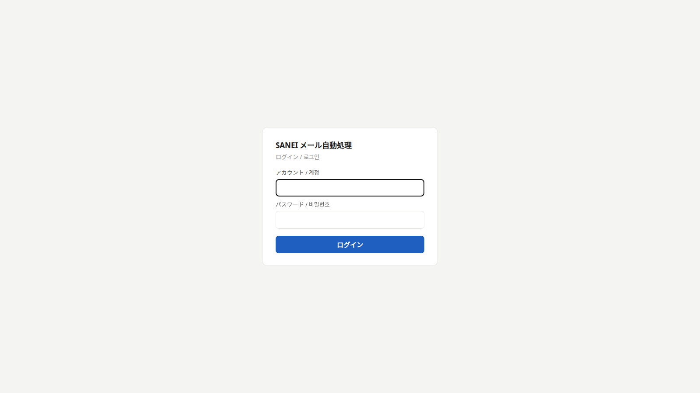
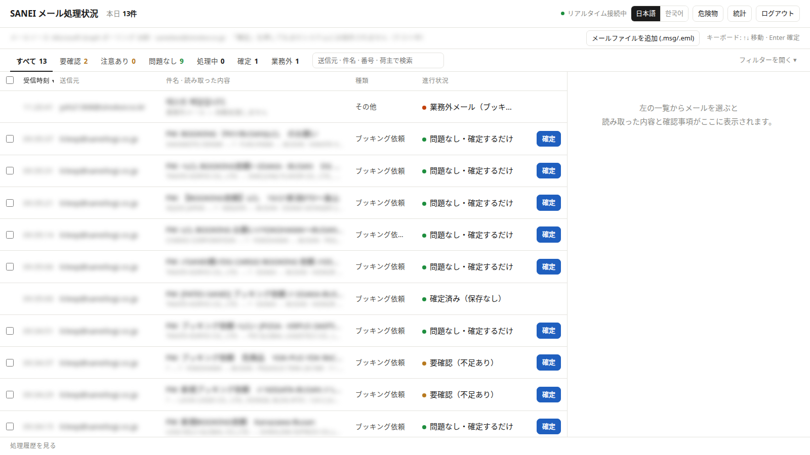
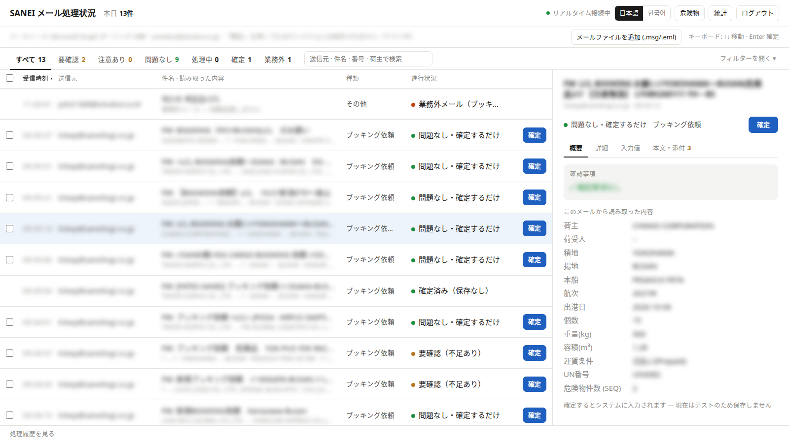
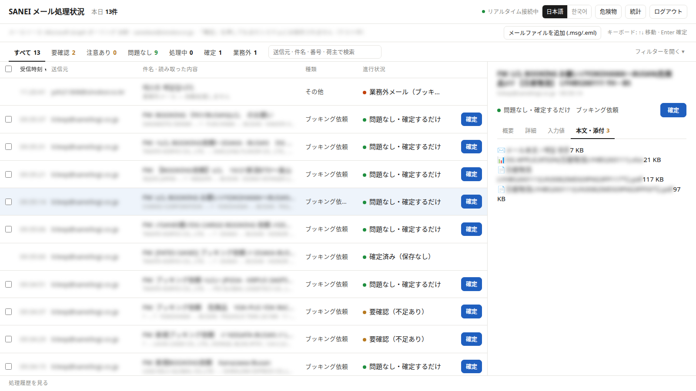
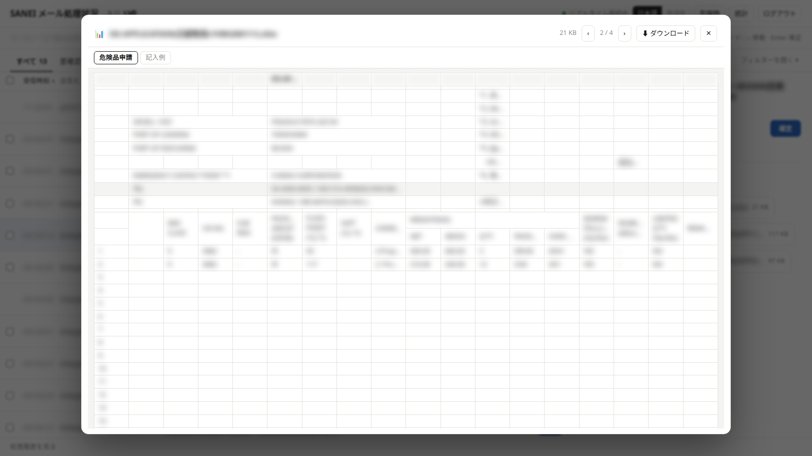
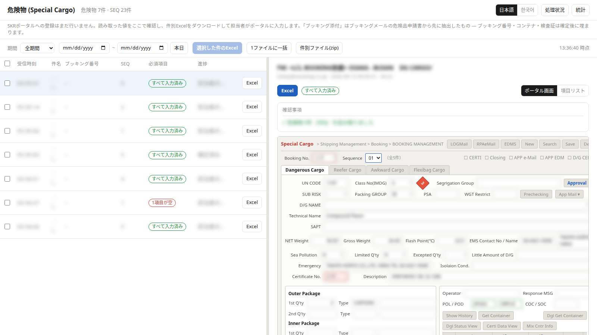
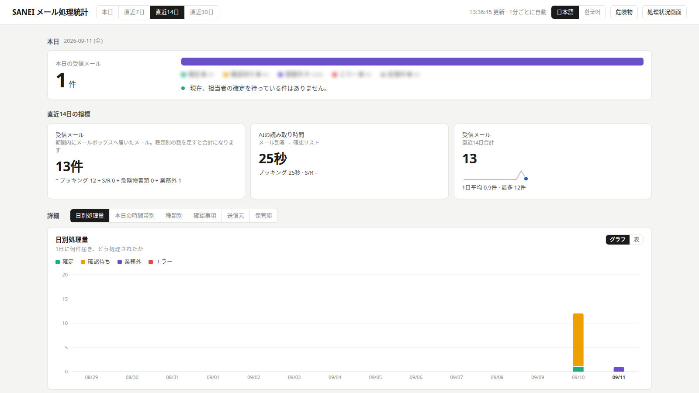

# SANEI 메일 자동처리 — 화면 사용법

부킹 의뢰·S/R(선적서류)·위험물 서류·수입 A/N 메일을 AI가 읽어내고, 담당자가 **확인하고 확정**하는 화면입니다.
이 문서는 "화면에서 무엇을 보고, 무엇을 누르는가"만 설명합니다. 日本語版は [こちら](index.md)。

!!! note "무엇이 자동이고 무엇이 수동인가"
    - **자동**: 메일 수신 → 종류 판정 → 내용 읽기 → 확인 목록에 표시
    - **수동(담당자)**: 읽어낸 값 확인 → 틀린 값은 화면에서 고침 → **[확정]**
    - **확정하면 실제로 저장됩니다**
        - 부킹 → ULOGI 부킹 저장, 부킹번호가 화면에 표시
        - S/R → ULOGI 수출 House B/L 저장
        - 수입 A/N → ULOGI 수입 House B/L 의 Co-Load Agent·Warehouse, Master B/L No.
        - 위험물 → 포털에서 가져갈 수 있게 자동 적재 (포털 화면 반영은 포털 담당 부서가 진행 중)
    - 확정한 뒤에는 화면에서 고칠 수 없습니다. 확정 전에 **입력값** 탭에서 고치세요

!!! warning "화면 사진은 2026-09 기준입니다"
    이후 **[확정]**·값 고치기·수입 A/N 화면이 추가되어 버튼 위치·문구가 사진과 조금 다를 수 있습니다. 글이 기준입니다.

---

## 1. 로그인

- 담당자에게 배포된 계정·비밀번호를 입력합니다. 한 번 로그인하면 14일간 유지됩니다. 오른쪽 위 **[로그아웃]**
- 오른쪽 위 **[日本語] [한국어]** 로 화면 언어를 바꿉니다
- 계정마다 담당 업무가 달라 보이는 메뉴가 다릅니다
    - 부킹·S/R·수입 A/N 담당 계정: **전체 / 부킹 / S/R / 수입 A/N / 통계**
    - 위험물 담당 계정(도쿄·흥아): **위험물 / 통계**
- 다른 계정의 건은 보이지 않습니다

---

## 2. 처리 현황 (메인 화면)

받은 메일이 **최신순**으로 놓입니다. 1행 = 메일 1통. 한 메일에 부킹과 위험물 서류가 같이 왔으면 두 화면에 모두 나옵니다.

| 열 | 뜻 |
|---|---|
| 받은 시간 | 메일이 도착한 시각 (부킹일은 이 날짜가 됩니다) |
| 보낸 곳 | 발신자 |
| 제목·읽어낸 내용 | 위는 제목, 아래는 AI 요약(화주 → 수하인 · 출발항 → 도착항 · 선박 · 개수/중량). **수정건**·**새 요청** 표시 |
| 종류 | 부킹 요청 / 선적 서류(S/R) / 위험물 서류 / 수입 A/N / 업무 외 |
| 진행 상황 | 아래 표 |
| (맨 오른쪽) **[확정]** | 확인이 끝나면 누르는 버튼 (상태가 아닙니다) |

### 진행 상황 읽는 법

| 표시 | 뜻 | 할 일 |
|---|---|---|
| ● **이상 없음 · 확정만 하면 됨** | 필요한 값이 다 있음 | 내용 보고 **[확정]** |
| ● **참고 N건 · 확인 후 확정** | 참고할 점 N건 | 오른쪽 "확인할 점" 보고 **[확정]** |
| ● **확인 필요 (빠진 값 있음)** | 화주·항구·일정 등 없으면 저장 못 하는 값이 빠짐 | 원문 보고 **입력값** 탭에서 채운 뒤 **[확정]** |
| ● **확정됨 · ULOGI 저장됨 · 번호** | 저장 완료. 부킹은 부킹번호, S/R 은 House B/L 번호 | 없음 (화면에서 더 고칠 수 없음) |
| ● **업무 외 메일** | 부킹·S/R·위험물·A/N 이 아닌 메일(문의·자동응답 등) | 할 일 없음 |
| ● **문제 발생** | 서류를 읽지 못함 | 행의 **[다시 처리]** 또는 IT 담당에게 |

### 상단 탭·검색·버튼

- **전체 / 확인 필요 / 참고 있음 / 이상 없음 / 처리 중 / 확정 / 업무 외** — 건수 표시, 누르면 목록이 걸러집니다
- 검색 — 보낸 곳·제목·부킹번호·화주
- **[필터 더 보기]** — 종류·기간, 목록 CSV 내려받기
- **[메일 파일 올리기 (.msg/.eml)]** — 사서함을 거치지 않은 메일을 직접 올립니다. 화면에 끌어다 놓아도 됩니다. 이미 올린 메일은 중복으로 걸러집니다
- 여러 행 체크 → **[선택한 N건 확정]** / **[선택한 N건 삭제]**. 키보드 ↑↓ 이동, Enter 확정

### [확정] 을 누르면

1. **필수값이 빠져 있으면** "그래도 확정하시겠습니까?" 확인창 — 그대로 확정하면 빠진 값은 ULOGI 에서 담당자가 직접 채워야 합니다. 보통은 **[취소]** 하고 입력값 탭에서 채운 뒤 다시 확정합니다
2. **같은 화주·배·일정에 화물(CBM·중량·개수·품목)까지 같은 부킹이 이미 있으면** 중복 확인창 — 실제 화주가 다른 별개 부킹이면 **[확인]**(새 번호 채번), 같은 부킹이면 **[취소]**
3. 저장되면 진행 상황이 **확정됨 · ULOGI 저장됨 · 번호** 로 바뀝니다
4. **저장 실패** 가 뜨면 건은 확정되지 않고 그대로 남습니다. 이유를 보고 다시 확정하거나 ULOGI 에 직접 입력하세요

!!! note "출항일(ETD)·출발항(POL) 이 없으면 저장되지 않습니다"
    ULOGI 가 이 두 값으로 부킹번호를 만듭니다. 입력값 탭에서 채운 뒤 확정하세요.

### 삭제 · 다시 처리

- **[삭제]** — 목록·첨부 보관·통계에서 지워지고 되돌릴 수 없습니다. ULOGI 에 **저장된 건은 삭제할 수 없습니다**(이력 유지). ULOGI 데이터는 바뀌지 않습니다
- **[다시 처리]** — 지금 건을 지우고 사서함에서 원문을 다시 받아 처음부터 처리합니다 (읽기 실패한 건에 씁니다)

---

## 3. 오른쪽 읽기 패널

| 탭 | 내용 |
|---|---|
| **요약** | 확인할 점 + AI가 읽어낸 값(화주·수하인·출발/도착항·선박·항차·출항일·개수·중량·용적·운임조건·UN번호) |
| **자세히** | 종류 판단 이유, 첨부 파일명, 입력될 곳(ULOGI 부킹 화면 등), 걸린 시간, 처리 기록 |
| **입력값** | ULOGI 에 그대로 들어갈 값(ULOGI 항목명). **여기서 값을 고칩니다** |
| **원문·첨부 N** | 메일 원문(서식 그대로)과 첨부. **원본 서류와 읽어낸 값을 대조**하는 탭 |

### 값 고치기 (입력값 탭)

1. **[✎ 값 고치기]** → 고칠 칸에 입력 (고친 칸은 색이 바뀌고 "원래: …" 가 함께 보입니다)
2. **[저장]** → 확인할 점이 다시 계산됩니다 (예: 화주를 채우면 "화주가 없습니다" 가 사라짐)
3. 그 다음 **[확정]**
- **[처음 값으로 되돌리기]** — 고친 값을 모두 버리고 처음 읽어낸 값으로
- 확정 대기·확인 필요 상태에서만 고칠 수 있고, **ULOGI 에 저장된 건은 잠깁니다**
- 고친 내용은 기록되어 판독 정확도 개선에 씁니다. ULOGI 에서 직접 고치면 기록이 남지 않으니 가능하면 여기서 고친 뒤 확정하세요

!!! tip "확인할 점에 뜨는 것"
    **확인 필요(빨강)** 는 저장을 막는 것만 — "화주가 없습니다" "출발/도착 항구 불명" "선박·출항일이 모두 없습니다" "UN 번호가 빠져 있습니다",
    그리고 읽어낸 거래처 이름이 시스템 거래처와 **비슷하지만 다를 때**("같은 회사인지 확인 필요").
    운임조건·중량이 비어도 저장에 지장이 없어 참고로만 표시합니다.

---

## 4. 원문·첨부 뷰어

- 첫 항목 **✉️ 메일 원문** — HTML 서식·표·붙여넣은 이미지(스케줄 캡처 등)가 그대로 보입니다
- 이어서 첨부 파일. 누르면 그 자리에서 열립니다

| 형식 | 표시 |
|---|---|
| PDF | 브라우저 내장 뷰어(확대·페이지 이동·검색) |
| Excel | 시트별 탭, 표로 읽기 |
| 이미지 | 그대로 표시 |
| 그 외 | 내려받기 |

← → 로 이전/다음 첨부, Esc 로 닫기. 오른쪽 위 **[내려받기]**. 원본 `.msg`도 여기서 받을 수 있습니다.

---

## 5. 위험물 (Special Cargo) 화면

상단 메뉴 **[위험물]**. SKR 포털 Special Cargo 에 들어갈 항목을 **포털 화면과 같은 배치**로 확인하고 **확정**합니다.

- 목록은 "위험물 서류 메일"과 "부킹·S/R 메일에 딸려 온 위험품 서류(**부킹 메일과 함께 / S/R 메일과 함께** 표시)" 둘 다. 지난 건도 보관함에 남아 있는 동안은 보입니다
- **Sequence** 드롭다운으로 품목(SEQ) 전환 — SEQ 는 부킹번호마다 1부터
- **빨간 "필수"** 칸 — 포털 필수값인데 서류에 없는 것: Booking No. · UN CODE · Class No(IMDG) · SUB RISK · Packing GROUP · Container No.
- **초록 테두리** — 자동 변환된 값(항구명→코드, TANK→T/C, NET 0→총중량 등). **자동 보정** 내역이 아래에 적힙니다
- 오른쪽 위 **[포털 화면] / [항목 목록]** 표시 전환. 값을 누르면 복사됩니다
- 흥아(HASL) LCL 건은 **부킹번호 없이 진행** 으로 표시됩니다

### 확정

- **[확정]** 은 위험물 서류 메일 건에만 있습니다 (부킹·S/R 에 딸린 위험물은 그 메일 화면에서 확정)
- 필수값이 빠져 있으면 "그래도 확정하시겠습니까?" — 그대로 확정하면 포털에서 담당자가 직접 채워야 합니다
- 확정한 건은 **확정됨**(확정한 사람·시각) 으로 바뀌고, 1분 안에 포털이 가져갈 수 있게 적재됩니다. **확정 후에는 고칠 수 없습니다**
- 여러 건 체크 → **[선택한 N건 확정]**
- **30일 이상 지난 건은 확정할 수 없습니다** ("N일 지남 · 확정 불가")

### 값 고치기

- 칸을 **두 번 누르면** 수정 → **[저장]** / **[되돌리기]**. 컨테이너 줄 추가·삭제도 됩니다
- 확정 대기·확인 필요 상태에서만. 부킹·S/R 메일에 딸려 온 위험물은 그 메일 화면에서 고칩니다

### 엑셀

- **[엑셀]** — 건별 파일. 체크한 건을 **한 파일로 일괄**(SEQ 1건 = 1행) 또는 **건별 파일 묶음(zip)**
- 열 이름 = 포털 화면 항목명. 필수값 빈 칸은 주황색. 시트 3개 = Special Cargo · Containers · 메일정보

### 문제 발생

- 서류를 읽지 못한 메일은 목록 위 **"문제 발생 N건"** 띠에 따로 나옵니다 → **[다시 처리]**. 직접 올린 파일이면 지우고 다시 올립니다

---

## 6. 수입 A/N 화면

상단 메뉴 **[수입 A/N]**. CO-LOADER 가 보낸 도착통지서(A/N)를 읽어 **이미 등록된 수입 House B/L** 에 Master B/L No. · Co-Load Agent · Warehouse 를 채웁니다.

- 올리는 방법 — 둘 중 하나
    1. A/N 메일을 첨부파일째 사서함으로 전달 → 1분쯤 뒤 이 화면에 올라옵니다
    2. **[A/N 올리기 (PDF·이미지)]** 또는 화면에 끌어다 놓기 (PDF·이미지만. 본문·텍스트에 적힌 A/N 은 읽지 않습니다)
- 목록: 올린 시각 · 파일 · B/L 번호 · 반입 창고 · 붙일 House B/L · 진행
- 오른쪽: **읽어낸 값**(B/L 번호 · 선사 B/L · 발행 회사 · 반입 창고 · NACCS · 반입확인번호 · 양륙항 · 본선/항차 · ETA · 환율 · 컨테이너), **ULOGI 에 넣을 값**(House B/L · Master B/L No. · Co-Load Agent · Warehouse), **확인 사항**
- 틀린 값은 **[수정]** → 칸 고침 → **[저장]** (확정 전에만)
- **[확정]** → ULOGI 에 반영됩니다. 확인 사항이 남아 있으면 "그래도 확정하시겠습니까?" 가 뜹니다
- **확인 필요** 로 멈추는 경우: 발행 회사가 코로더 목록에 없음 / 반입 창고를 못 읽음 / ULOGI 에서 붙일 House B/L 을 못 찾음. 코로드 건이 아니거나(파트너 직송) House B/L 을 아직 등록하지 않은 경우입니다. House B/L 을 등록한 뒤 같은 파일을 다시 올리면 다시 찾습니다

---

## 7. 통계

상단 메뉴 **[통계]**. 오늘/7일/14일/30일 전환, 1분마다 자동 갱신.

- **받은 메일** — `= 부킹 + S/R + 위험물 서류 + 업무 외`. 더하면 전체와 같습니다
- **AI가 읽는 데 걸린 시간** — 메일 도착 → 확인 목록
- **확정까지 기다린 시간** — 확인 목록 → 담당자 확정 (중간값)
- **받은 메일 추세** — 일별
- 아래 탭: 일별 처리량, 오늘 시간대별, 종류별, 보낸 곳, 보관함(보관 기간: 부킹/S/R/위험물 365일, 업무 외 90일)

---

## 8. 자주 묻는 질문

**Q. 목록에 없는 메일이 있다**
A. 30초마다 사서함을 확인합니다. 30초를 기다려도 안 뜨면 상단 접속 표시(● 실시간 연결됨)를 확인하세요. 다른 계정 담당 건은 보이지 않습니다.

**Q. 읽어낸 값이 틀렸다**
A. 확정 전이면 **입력값** 탭 **[✎ 값 고치기]** 로 고친 뒤 **[저장]** → **[확정]**. 고친 내용은 기록되어 정확도 개선에 씁니다.

**Q. 확정을 눌렀는데 ULOGI 에 안 들어갔다**
A. 진행 상황이 **확정됨 · ULOGI 저장됨 · 번호** 인지 보세요. **저장 실패** 알림이 떴으면 확정되지 않은 것이니 이유를 보고 다시 확정하거나 직접 입력하고, 반복되면 IT 담당에게 알려주세요.

**Q. 확정한 뒤 틀린 걸 발견했다**
A. 화면에서는 고칠 수 없습니다. ULOGI 에서 고치고 IT 담당에게 알려주세요.

**Q. "업무 외"에 업무 메일이 들어갔다 / 부킹이 "업무 외"로 갔다**
A. 제목과 본문을 IT 담당에게 전달해 주세요. 판정 규칙을 고칩니다.

**Q. 위험물 건에 [확정] 이 없다**
A. 부킹·S/R 메일에 딸려 온 위험물이거나, 30일이 지난 건입니다. 전자는 그 메일 화면에서 확정합니다.

---

*문의: 장금상선 전산팀*
